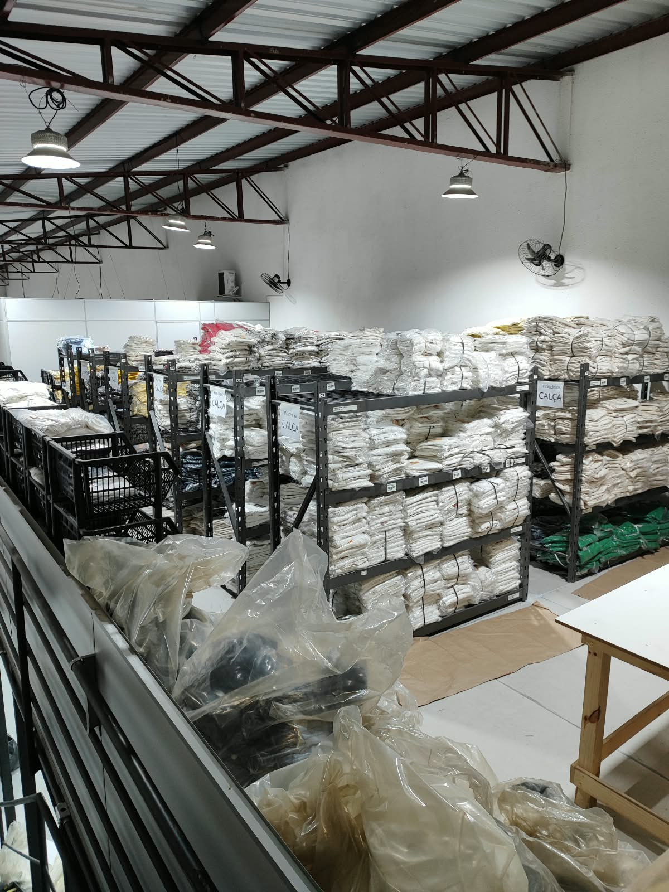
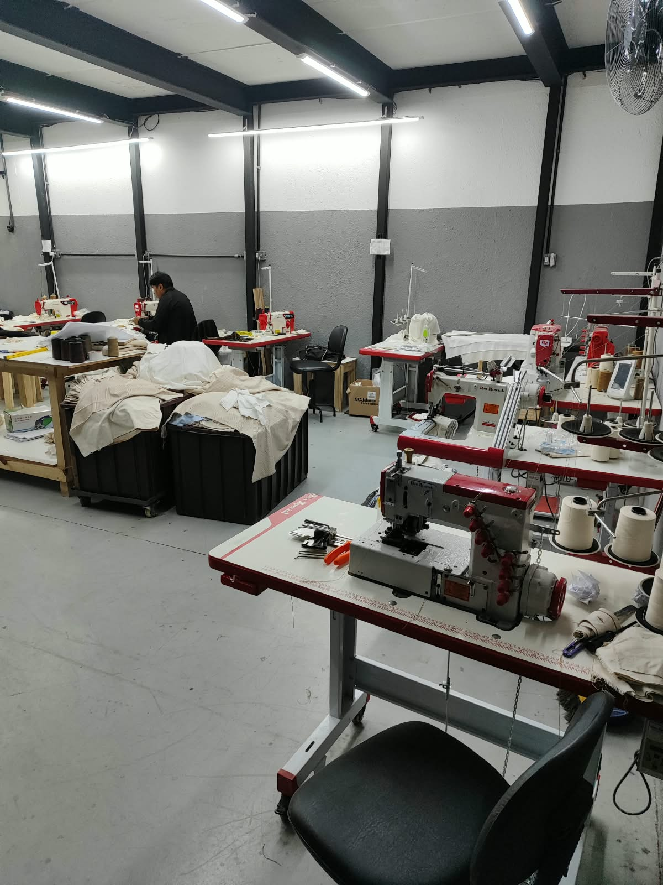
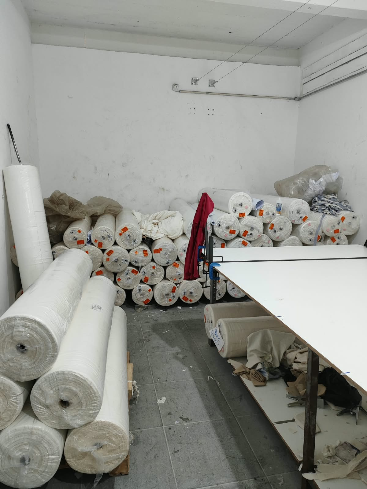
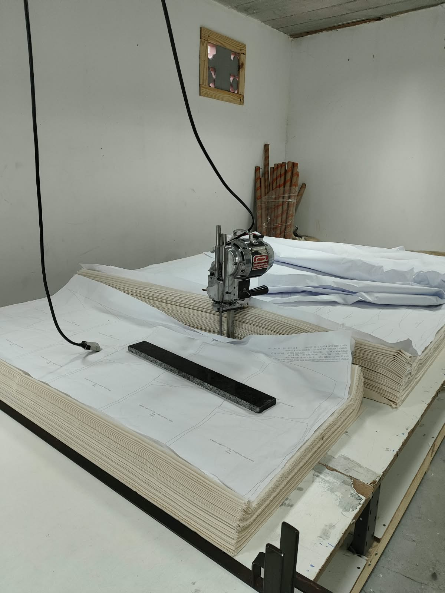
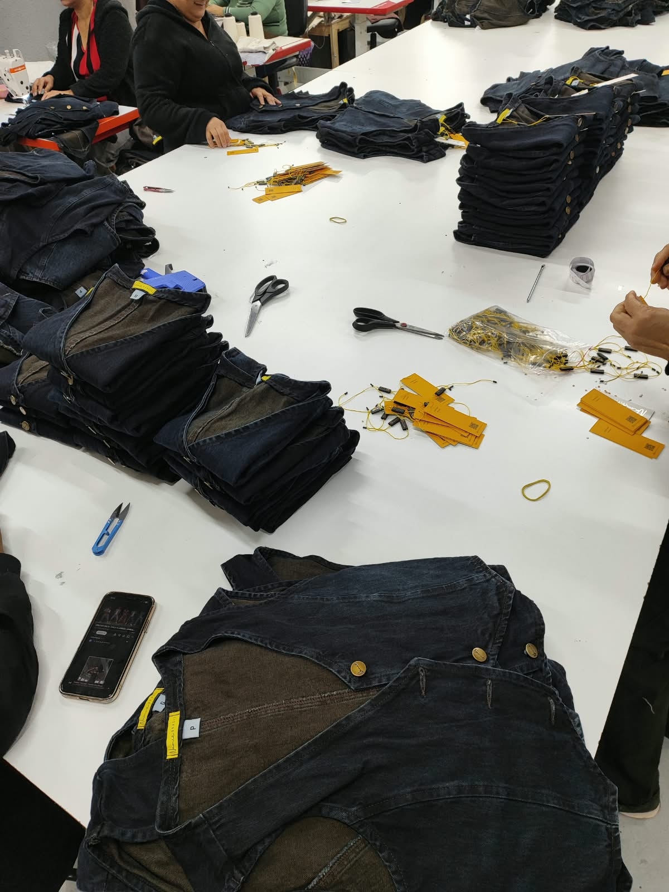
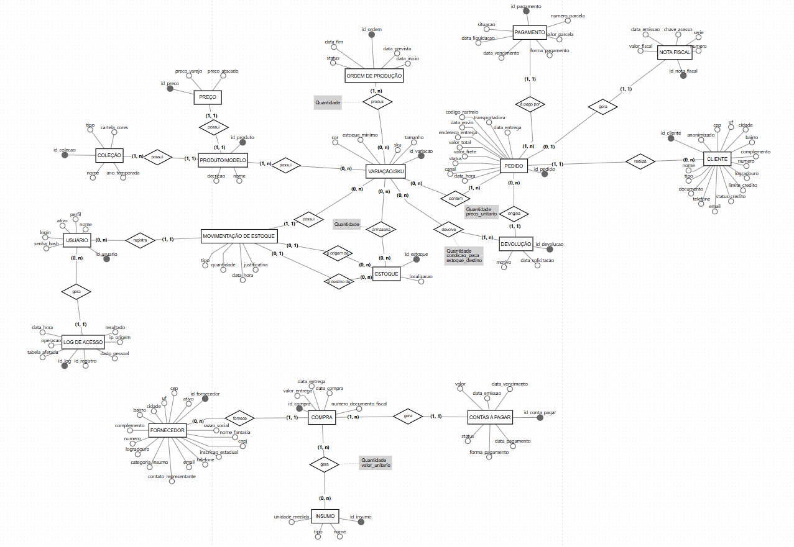
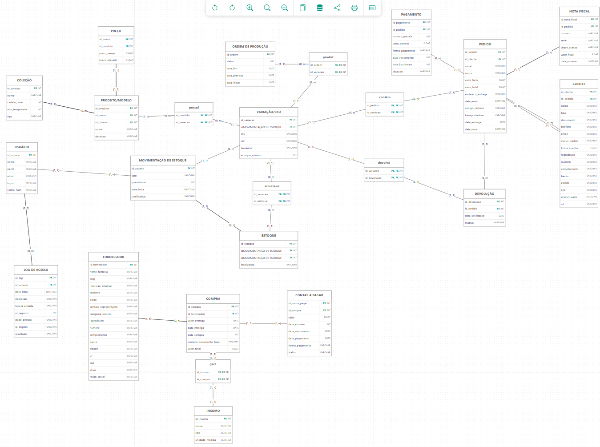

# Relatório Técnico Final — Namiê Brasil Ltda.
### Entrega 2 — Tópico 1: 

## Integrantes

| Nome completo do aluno | RGM | Usuário do GitHub |
|---|---|---|
| Felipe Piazza Bononi | 47349361 | FelipeBononi |
| Lucas Fortes de Melo | 46761977 | FortesLucas208 |
| Vinicius Passos Macedo | 47116871 | viniciusravini-hub |

**Arquivos do projeto:** · [DER](imagens/DER.png) · [Modelo Lógico](imagens/mdl.png) · [Dicionário de dados](dicionario-dados-namie-brasil.html) 

---

## 1.1 Revisão do Modelo Conceitual

### Caracterização da organização

**Nome e natureza.** Namiê Brasil Ltda., empresa com fins lucrativos do segmento de moda feminina. Fabrica e vende roupas, principalmente jeans feminino, no atacado e no varejo. O cadastro público da empresa indica como atividade principal a confecção de peças do vestuário, e como secundárias o comércio atacadista e varejista de vestuário.

**Contexto e porte.**
- Local: bairro do Brás, São Paulo – SP. Sede na Rua Piratininga, 514, conjunto 500, CEP 03042-000.
- Cerca de **50 pessoas** nos setores de produção, costura, acabamento, expedição, pontos de venda, e-commerce, financeiro, recursos humanos e diretoria.
- **3 lojas físicas**, site oficial e marketplaces.
- Atacado (feira e WhatsApp), para revendedoras e lojistas. Varejo (site e marketplaces), para consumidor final.
- Produção 100% própria: corte, costura, lavanderia e acabamento.
- **4 estoques:** Geral (fábrica), Feira, Online e Defeitão.
- Sistemas usados hoje: Omiê (matéria-prima, corte, costura e acabamento), planilhas (produtos acabados, estoque geral e da feira) e Bling ERP (vendas online e estoque online).

**Problemas e necessidades.** Levantados na Entrega 1 e numerados agora:

| Cód. | Problema |
|---|---|
| **P1** | O estoque está espalhado em Omiê, planilhas e Bling, sem uma visão única do saldo de cada SKU por local. |
| **P2** | As planilhas não são atualizadas no momento da movimentação, o que gera divergência entre o estoque registrado e o real. |
| **P3** | Uma peça pode ser vendida sem confirmar se há estoque disponível. |
| **P4** | Nas vendas da feira, a baixa das peças pode ser imediata ou posterior, o que gera divergência. |
| **P5** | Não há estoque mínimo definido: a necessidade de produzir ou repor só aparece quando o saldo acaba. |

**Escopo do sistema.** O banco guarda os dados de catálogo (coleção, modelo, SKU e preço), produção, estoque, vendas (clientes, pedidos, pagamentos, notas fiscais e devoluções), compras e financeiro (fornecedores, insumos, compras e contas a pagar) e segurança (usuários e log de acesso). Os problemas P1 a P5 estão ligados a estoque e vendas, mas o modelo cobre a operação toda.

**Justificativa da escolha.** A Namiê é uma empresa real, com produção, estoque e vendas em vários canais, o que dá variedade de dados para modelar. O contato com a empresa veio de Anthony Werick, que trabalha lá e era do grupo antes de transferir a matrícula para EAD. Esse vínculo não substitui a entrevista com o responsável, que foi feita na empresa.

**Evidências.**
- Endereço: Rua Piratininga, 514, conj. 500, Brás, São Paulo – SP, CEP 03042-000
- Site: https://www.namiebrasil.com.br/
- Instagram: https://www.instagram.com/namiebrasil/
- E-mail: namiebrasil@gmail.com

| | |
|---|---|
|  |  |
|  |  |
|  |  |

**Responsável pela organização:** Mirellen Namie Yanachi, Fundadora e CEO da Empresa · telefone (11) 97167-5752

### Relato da entrevista

- **Quem:** entrevistada a Fundadora e CEO da empresa, Mirellen Namie Yanachi. Entrevistador: Anthony Eloi, ex-membro do grupo.
- **Quando e onde:** na sede da empresa, em 14/09/2026. A foto `foto6.jpeg` mostra a reunião com a gerência. As fotos `foto1` a `foto5` mostram o chão de fábrica.
- **Comprovação:** `imagens/foto6.jpeg` (JPG no repositório).
- **O que foi levantado:**
  - *Nas respostas do entrevistado:* como a produção funciona (a diretoria define modelo e tecido, a fábrica compra a matéria-prima quando falta, e faz corte, costura, lavanderia e acabamento); os canais de venda e o público de cada um; o uso de Omiê, planilhas e Bling; a falta de estoque mínimo; as vendas sem checagem de saldo; a baixa da feira imediata ou posterior.
  - *Na observação no local:* o grupo viu planilhas impressas e anotações sobre a mesa de reunião e o controle da fábrica por câmeras, o que confirma o uso de papel e planilha no dia a dia.
  - *Mudanças em relação à Entrega 1:* não houve nova visita para esta etapa; foram mantidos os processos e as regras já levantados.

### Nível de detalhe

Nos processos, requisitos e regras abaixo, cada item cita os dados envolvidos (campos do DER e do dicionário).

### Processos de negócio

| # | Processo | Dados envolvidos | Regras |
|---|---|---|---|
| 1 | Venda no atacado (feira e WhatsApp) | pedido (data_hora, canal, status, valor_total); itens (SKU, quantidade, preco_unitario de atacado); cliente | RN05, RN06, RN07, RN13 |
| 2 | Venda no varejo (site e marketplaces) | pedido (canal, valor_frete, endereco_entrega); itens (SKU, quantidade, preco_unitario de varejo) | RN05, RN06, RN07 |
| 3 | Cadastro de clientes e revendedoras | nome, tipo, documento, telefone, email, status_credito, limite_credito, endereço, anonimizado | RN14, RN17 |
| 4 | Recebimento e pagamento das vendas | numero_parcela, valor_parcela, forma_pagamento, data_vencimento, data_liquidacao, situacao | RN14 |
| 5 | Nota fiscal, separação e expedição | numero, serie, chave_acesso, data_emissao, valor_fiscal; data_envio, codigo_rastreio, transportadora | RN15 |
| 6 | Devoluções e trocas | data_solicitacao, motivo; SKU, quantidade, condicao_peca, estoque_destino | RN10, RN11, RN16 |
| 7 | Compra de matéria-prima | numero_documento_fiscal, data_compra, data_entrega, valor_total; insumo, quantidade, valor_unitario | RN18, RN19 |
| 8 | Cadastro de fornecedores | razao_social, cnpj, inscricao_estadual, contatos, categoria_insumo, endereço, ativo | RN18 |
| 9 | Contas a pagar | valor, data_emissao, data_vencimento, data_pagamento, forma_pagamento, status | RN19 |
| 10 | Produção própria | data_inicio, data_prevista, data_fim, status; SKU e quantidade produzida | RN08, RN09 |
| 11 | Controle de estoque e transferências | saldo por SKU e estoque; tipo, quantidade, data_hora, origem, destino, justificativa, usuário; estoque_minimo | RN03, RN04, RN12 |
| 12 | Tratamento de defeitos ("Defeitão") | SKU, quantidade, motivo, estoque de destino | RN10 |

**Processos comuns que ficaram de fora e por quê:**
- *Terceirização da produção (facção):* a empresa faz corte, costura, lavanderia e acabamento por conta própria (RO03).
- *Folha de pagamento e ponto (RH):* a empresa tem setor de RH, mas os problemas declarados são de estoque e vendas, e o grupo não levantou esse processo. Fica como possível expansão.
- *Controle separado de cada uma das 3 lojas:* o levantamento trouxe só o estoque "Feira". Como `tb_estoque.localizacao` é VARCHAR, cada loja pode virar um estoque novo sem mudar o modelo.
- *Contas a receber:* as parcelas de venda já ficam em `tb_pagamento`.
- *Despesas fixas (aluguel, energia):* o financeiro modelado cobre só as obrigações das compras de matéria-prima.
- *Cancelamento de pedido:* existe como status `Cancelado` em `tb_pedido`, sem tabela própria.

### Requisitos

Cobertura dos problemas: **P1** → RF08, RF10, RF15, RNF06 · **P2** → RF09, RF10, RF15, RNF03 · **P3** → RF08 e RN05 · **P4** → RF09, RF22 e a baixa de estoque na emissão da nota · **P5** → RF19 e RN12.

#### Requisitos Funcionais

| ID | Requisito Detalhado com Dados Envolvidos |
|---|---|
| **RF01** | O sistema deve permitir cadastrar e consultar produtos/modelos com ID do produto, nome comercial, descrição detalhada e associação à coleção. |
| **RF02** | O sistema deve permitir cadastrar as variações de cada modelo com ID da variação, modelo vinculado, cor, tamanho e código SKU exclusivo. |
| **RF03** | O sistema deve permitir cadastrar e gerenciar coleções com ID da coleção, nome da coleção, ano/temporada e cartela de cores. |
| **RF04** | O sistema deve permitir cadastrar e consultar clientes com ID do cliente, tipo ('Consumidor Final' ou 'Revendedor'), nome/razão social, CPF/CNPJ validado e único, telefone, e-mail e endereço completo (logradouro, número, complemento, bairro, cidade, UF, CEP). |
| **RF05** | O sistema deve permitir registrar pedidos de venda no atacado vinculando cliente revendedor, data/hora, canal ('Atacado Feira' ou 'Atacado WhatsApp'), itens (SKU, quantidade, preço unitário de atacado) e valor total. |
| **RF06** | O sistema deve permitir registrar pedidos de venda no varejo vinculando cliente, data/hora, canal ('Site' ou 'Marketplace'), itens (SKU, quantidade, preço unitário de varejo), frete e valor total. |
| **RF07** | O sistema deve permitir adicionar, alterar e remover itens do pedido, recalculando automaticamente o valor total e preservando o preço unitário histórico praticado no momento da venda. |
| **RF08** | O sistema deve permitir consultar a disponibilidade física e lógica de cada SKU em cada localização de estoque (Geral, Feira, Online e Defeitão). |
| **RF09** | O sistema deve permitir registrar entradas e saídas de estoque com ID da movimentação, tipo ('Entrada', 'Saida'), SKU, estoque envolvido, quantidade, data/hora e justificativa. |
| **RF10** | O sistema deve permitir registrar transferências de estoque entre locais (Geral para Feira, Geral para Online), reduzindo o saldo da origem e aumentando o do destino de forma atômica e rastreada. |
| **RF11** | O sistema deve permitir segregar e transferir peças defeituosas, amostras danificadas ou itens devolvidos com avaria para o estoque "Defeitão", impedindo sua exibição no estoque vendável. |
| **RF12** | O sistema deve permitir registrar ordens de produção (OP) com ID da ordem, data de início, data de término prevista, data de conclusão real e status da produção. |
| **RF13** | O sistema deve permitir associar as quantidades produzidas na OP às respectivas variações/SKUs de produtos acabados. |
| **RF14** | O sistema deve permitir registrar a entrada das peças acabadas aprovadas pela expedição diretamente no Estoque Geral da fábrica após a conclusão da OP. |
| **RF15** | O sistema deve permitir consultar o histórico completo de movimentações de estoque por SKU, período, tipo de operação e estoque. |
| **RF16** | O sistema deve permitir consultar pedidos de venda por cliente, período, canal, status do pedido e status de faturamento. |
| **RF17** | O sistema deve diferenciar as tabelas de preços praticadas, associando a cada modelo o preço de atacado e o preço de varejo. |
| **RF18** | O sistema deve permitir identificar e filtrar as operações por canal de venda (Feira, WhatsApp, Site, Marketplace). |
| **RF19** | O sistema deve permitir cadastrar e monitorar a quantidade de **estoque mínimo por SKU** no Estoque Geral, gerando alerta de reposição preventiva quando o saldo for menor ou igual ao mínimo. |
| **RF20** | O sistema deve validar a **quantidade mínima total de peças** em pedidos de atacado, impedindo a finalização de pedidos atacadistas abaixo da cota estipulada pela empresa. |
| **RF21** | O sistema deve registrar as **formas de pagamento** (Pix, Dinheiro, Cartão, Boleto) e controlar parcelas com valores e datas de vencimento para vendas a prazo a revendedoras cadastradas. |
| **RF22** | O sistema deve registrar e vincular a **Nota Fiscal Eletrônica (NF-e/NFC-e)** a cada pedido faturado, contendo número da nota, série, chave de acesso de 44 dígitos, data de emissão e valor total fiscal. |
| **RF23** | O sistema deve permitir registrar **devoluções de vendas**, capturando pedido de origem, SKU, quantidade, motivo, condição da peça e validando o prazo legal de 7 dias do CDC para compras online. |
| **RF24** | O sistema deve permitir cadastrar e consultar **fornecedores de matéria-prima** com razão social, nome fantasia, CNPJ validado e único, inscrição estadual, telefone, e-mail e endereço. |
| **RF25** | O sistema deve permitir registrar **compras de matéria-prima e aviamentos** com ID da compra, fornecedor, número do documento fiscal, data, itens adquiridos (insumo, unidade, quantidade, preço unitário) e valor total. |
| **RF26** | O sistema deve permitir gerenciar **contas a pagar** vinculadas às compras de matérias-primas, contendo valor, data de emissão, data de vencimento, data de liquidação e situação do pagamento. |
| **RF27** | O sistema deve permitir a **anonimização de dados de clientes** conforme a LGPD, substituindo dados identificadores a pedido do titular, mantendo preservados os registros fiscais e contábeis obrigatórios. |

#### Requisitos Não Funcionais

| ID | Requisito Não Funcional |
|---|---|
| **RNF01** | **Usabilidade:** A interface do sistema deve ser objetiva e intuitiva, possibilitando a operação ágil por funcionários de chão de fábrica, vendedores de feira e operadores de expedição. |
| **RNF02** | **Segurança e Acesso:** Os dados confidenciais de clientes, custos de produção e financeiro devem possuir controle de acesso baseado em perfis/papéis (RBAC). |
| **RNF03** | **Auditoria e Rastreabilidade:** O banco de dados deve manter histórico imutável de todas as movimentações de estoque, pedidos faturados e transações financeiras. |
| **RNF04** | **Desempenho:** As consultas de disponibilidade de estoque por SKU e localização devem responder em tempo inferior a 2 segundos em situações de alta concorrência. |
| **RNF05** | **Confiabilidade e Backup:** O sistema deve dispor de rotinas automatizadas de backup periódico e recuperação contra desastres para garantir a integridade dos dados operacionais. |
| **RNF06** | **Integridade Referencial e Transacional:** O banco de dados deve utilizar transações ACID para garantir que movimentações de estoque, faturamentos e pagamentos ocorram de forma atômica e consistente. |
| **RNF07** | **Concorrência:** O banco de dados deve suportar acessos simultâneos de múltiplos usuários operando vendas na feira, e-commerce, almoxarifado e fábrica sem travamentos ou condições de corrida. |
| **RNF08** | **Conformidade Legal e Regulatória:** O armazenamento e processamento de informações devem cumprir a legislação fiscal brasileira (NF-e/SEFAZ), o Código de Defesa do Consumidor (CDC) e a LGPD (Lei nº 13.709/2018). |

### Regras de negócio

Regras vigentes, mantendo os códigos da Entrega 1.

#### Regras operacionais

- **RN01 — Identificação de produtos e variações (SKU):**  
  Todo produto fabricado ou comercializado deve ser modelado com base na combinação de modelo, cor e tamanho, gerando um código SKU único para cada variação física da peça.
- **RN02 — Associação entre produto e coleção:**  
  Cada produto/modelo pertence a uma coleção específica, sendo a coleção associada à temporada e à paleta de cores desenvolvida pela confecção.
- **RN03 — Controle de estoque por localização/canal:**  
  Os produtos acabados devem ter saldos gerenciados de forma individualizada de acordo com o local de armazenagem: Estoque Geral (Fábrica), Estoque Feira (Ponto de venda presencial), Estoque Online (E-commerce) e Estoque Defeitão (Não conformes).
- **RN04 — Transferência controlada entre estoques:**  
  Toda transferência de peças (ex.: Geral para Feira ou Geral para Online) exige registro formal da movimentação, abatendo o saldo do estoque de origem e adicionando ao estoque de destino de forma síncrona.
- **RN05 — Disponibilidade prévia para venda:**  
  Um item só pode ser vendido se houver saldo positivo disponível no estoque específico do canal em que o pedido está sendo gerado (Estoque Online para site/marketplaces; Estoque Feira para vendas na feira).
- **RN06 — Diferenciação de preços atacado e varejo:**  
  Cada produto/modelo possui tabela de preços distinta, garantindo que compras no atacado utilizem o valor de atacado e compras no e-commerce utilizem o valor de varejo.
- **RN07 — Composição e integridade do pedido:**  
  Todo pedido de venda deve estar obrigatoriamente vinculado a um cliente cadastrado e conter pelo menos um item. Cada item registra o SKU, a quantidade vendida e o preço unitário praticado no momento da venda (imutável historicamente).
- **RN08 — Registro detalhado de produção por variação:**  
  Toda produção fabril deve ser controlada por Ordem de Produção (OP), especificando com exatidão a quantidade produzida por SKU.
- **RN09 — Entrada de produtos acabados no estoque geral:**  
  Ao ser finalizada e inspecionada pela expedição, a produção aprovada deve ser automaticamente lançada como entrada de saldo no Estoque Geral da fábrica.
- **RN10 — Segregação de produtos defeituosos ("Defeitão"):**  
  Peças reprovadas no controle de qualidade, danificadas em transporte/feira ou devolvidas com defeito devem ser transferidas para o estoque "Defeitão", ficando bloqueadas para venda convencional.
- **RN11 — Retorno de devoluções íntegras ao estoque:**  
  Peças devolvidas de vendas online que passarem por inspeção e apresentarem condições intactas de comercialização devem retornar ao saldo do Estoque Online.
- **RN12 — Controle de estoque mínimo por SKU (Reposição preventiva):**  
  Cada variação/SKU deve possuir uma quantidade mínima estipulada para o Estoque Geral (`estoque_minimo`). Quando o saldo atingir valor menor ou igual ao mínimo, o sistema deve emitir alerta gerencial de reposição para evitar rupturas de estoque.
- **RN13 — Quantidade mínima de peças no atacado (Pedido mínimo):**  
  Pedidos realizados no canal de atacado (Feira e WhatsApp) devem respeitar uma quantidade mínima total de peças por pedido (definida pela gerência, ex.: mínimo de 12 peças no total), condição obrigatória para aplicação do preço atacadista.
- **RN14 — Formas e condições de pagamento:**  
  Todo pedido deve ter sua condição de pagamento registrada. Vendas online exigem liquidação prévia via gateway. Vendas no atacado são realizadas à vista (Pix, dinheiro, débito) ou a prazo (boleto parcelado), sendo o prazo concedido unicamente a revendedoras cadastradas e homologadas com limite de crédito liberado pela gerência.
- **RN15 — Emissão obrigatória de Nota Fiscal Eletrônica (NF-e/NFC-e):**  
  Todo pedido faturado deve ter emitida a respectiva nota fiscal antes da liberação e expedição da mercadoria, armazenando número, série, chave de acesso de 44 dígitos, data de emissão e valor total fiscal vinculado ao pedido.
- **RN16 — Direito de arrependimento em até 7 dias nas vendas online (CDC):**  
  Nas compras efetuadas fora do estabelecimento físico (site e marketplaces), o consumidor pode solicitar a devolução dos produtos em até 7 dias corridos após o recebimento comprovado da mercadoria, sem ônus ou justificativa de vício.
- **RN17 — Proteção e privacidade de dados pessoais (LGPD):**  
  Os dados pessoais coletados de clientes e revendedoras (CPF, e-mail, telefone, endereço) destinam-se exclusivamente ao processamento dos pedidos, entrega e obrigações fiscais. É garantido o direito de anonimização do cadastro a pedido do titular, preservando os registros fiscais legalmente exigidos.
- **RN18 — Cadastro e homologação de fornecedores:**  
  Toda aquisição de matéria-prima (tecidos e aviamentos) deve ser vinculada a um fornecedor previamente cadastrado e ativo com CNPJ regular.
- **RN19 — Vínculo de compras ao contas a pagar:**  
  Toda compra de matéria-prima gera automaticamente uma obrigação financeira no módulo de Contas a Pagar com datas de vencimento, valores e controle de quitação.

#### Restrições organizacionais, legais e fiscais

- **RO01 — Segregação de estoques por localização e canal (Restrição Organizacional):**  
  A organização opera estoques físicos descentralizados (Geral, Feira, Online e Defeitão). O modelo deve suportar saldos independentes por SKU em cada localização.
- **RO02 — Integração e centralização de sistemas legados (Restrição Tecnológica):**  
  A organização utiliza múltiplos softwares (Omiê, Bling e planilhas). O banco de dados modelado deve centralizar as entidades fundamentais da empresa para eliminar inconsistências.
- **RO03 — Fabricação própria verticalizada (Restrição Operacional):**  
  As etapas fabris de corte, costura, lavanderia e acabamento são realizadas 100% internamente. A entidade ORDEM_PRODUÇÃO reflete o controle interno da manufatura.
- **RO04 — Obrigatoriedade de documento fiscal (Restrição Fiscal — Legislação Tributária / SEFAZ):**  
  Exigência da legislação tributária brasileira para circulação de mercadorias no atacado e varejo. O sistema deve registrar os metadados da NF-e para conformidade fiscal.
- **RO05 — Direito de arrependimento no e-commerce (Restrição Legal — CDC, Lei nº 8.078/1990, Art. 49):**  
  Exigência legal de concessão do prazo de 7 dias para desistência de compra online. O modelo armazena a data de entrega e a data de solicitação da devolução para comprovar o prazo legal.
- **RO06 — Proteção de dados pessoais (Restrição Legal — LGPD, Lei nº 13.709/2018):**  
  Norma legal de tratamento e proteção de dados de clientes, prevendo minimização de dados, controle de acesso restrito e procedimento de anonimização.
- **RO07 — Política de concessão de crédito no atacado (Restrição Financeira / Organizacional):**  
  A concessão de venda a prazo para revendedoras é restrita à aprovação gerencial e limite de crédito prévio, visando conter riscos de inadimplência.

**Regras comuns que ficaram de fora e por quê:**
- *Prazo de garantia por defeito além dos 7 dias:* a devolução por defeito é aceita (RN10), mas o prazo não foi levantado.
- *Valor exato do pedido mínimo do atacado:* RN13 usa 12 peças como exemplo. O valor real é definido pela gerência.
- *Normas de segurança do trabalho:* não geram dados no banco de estoque, vendas e produção.

### Notação do DER conceitual

O DER e o modelo lógico foram feitos no BRModelo. O DER está em [`imagens/DER.png`](imagens/DER.png). Ele mostra as 18 entidades, os relacionamentos em losango, a cardinalidade (mín, máx) dos dois lados, e os atributos dos relacionamentos N:N (quantidade, preco_unitario etc.) ligados ao losango. Não há chaves estrangeiras no DER.



### Caso A — mesma organização da Entrega 1

A Namiê Brasil é a mesma organização da Entrega 1, então vale o Caso A.

| Apontamento da correção da E1 | O que mudou | Por quê |
|---|---|---|
| Entidades "Item do Pedido", "Item de Estoque" e "Item da Produção" no DER | Removidas. Viraram relacionamentos N:N com atributos: `contém` (quantidade, preco_unitario), `armazena` (quantidade) e `produz` (quantidade) | Os dados do item pertencem à associação entre as entidades |
| Dicionário sem SGBD, collation, tipos físicos, índices, log de acesso, papéis e LGPD | Dicionário refeito na versão 2.0, em nível físico (MySQL 8.0, InnoDB, utf8mb4), com índices, `tb_log_acesso`, permissões por perfil e LGPD | Necessário para implementar o banco e auditar o acesso |
| Dicionário em HTML diferente do README e do DER (Marca, Categoria, Facção, Endereço) | Dicionário realinhado ao DER; `tb_preco` ficou 1:1 com o produto e a Facção saiu | A produção é interna (RO03) e o DER é a referência |
| Entidades de pagamento, nota fiscal, devolução, fornecedor, compra e contas a pagar ausentes | Incluídas no DER | O banco precisa cobrir vendas, compras e financeiro, e não só o estoque |

---

## 1.2 Conversão do Modelo Conceitual para o Modelo Lógico

O DER tem **18 entidades** e **5 relacionamentos N:N**, e vira **23 tabelas** (18 de entidade + 5 associativas), com prefixo `tb_`.

- **Entidades → tabelas:** cada entidade virou uma tabela com chave primária própria (`id_...`, AUTO_INCREMENT). Ex.: COLEÇÃO → `tb_colecao`, VARIAÇÃO/SKU → `tb_variacao`, PEDIDO → `tb_pedido`.
- **Atributos → colunas:** cada atributo virou uma coluna com tipo MySQL (VARCHAR, DECIMAL, ENUM, DATE, DATETIME, TINYINT). O endereço foi dividido em logradouro, numero, complemento, bairro, cidade, uf e cep. Valores em dinheiro usam DECIMAL.
- **Relacionamentos → chaves:** relacionamento 1:N vira chave estrangeira no lado N (ex.: `tb_produto.id_colecao`, `tb_pedido.id_cliente`).
- **Cardinalidades:**

  | Tipo | Relacionamentos | Tratamento |
  |---|---|---|
  | 1:1 | Produto–Preço | FK com UNIQUE em `tb_preco.id_produto` |
  | 0..1:1 | Pedido–Nota Fiscal | FK com UNIQUE em `tb_nota_fiscal.id_pedido` (só pedido faturado tem nota) |
  | 1:N | Coleção–Produto, Produto–Variação, Cliente–Pedido, Pedido–Pagamento, Pedido–Devolução, Fornecedor–Compra, Compra–Conta a Pagar, Usuário–Movimentação, Usuário–Log, Variação–Movimentação, Estoque–Movimentação (origem e destino) | FK no lado N |
  | N:N | Variação–Estoque, Ordem–Variação, Pedido–Variação, Devolução–Variação, Compra–Insumo | Tabela associativa com PK composta pelas duas FKs e os atributos do relacionamento como colunas |

- **Tabelas associativas:** `tb_estoque_variacao` (quantidade), `tb_ordem_variacao` (quantidade), `tb_pedido_variacao` (quantidade, preco_unitario), `tb_devolucao_variacao` (quantidade, condicao_peca, estoque_destino) e `tb_compra_insumo` (quantidade, valor_unitario).
- **Estoque origem e destino:** a movimentação de estoque tem duas FKs opcionais para `tb_estoque` (`id_estoque_origem` e `id_estoque_destino`). Entrada tem só destino, saída só origem, e transferência os dois.
- **Generalização/especialização:** o DER não tem. Os tipos de cliente (Consumidor Final e Revendedor) são um ENUM, pois não têm atributos próprios.

---

## 1.3 Definição de Chaves Primárias e Estrangeiras

Todas as FKs usam `ON UPDATE CASCADE` e `ON DELETE RESTRICT`.

| Tabela | Chave primária | Chaves estrangeiras |
|---|---|---|
| `tb_colecao` | `id_colecao` | — |
| `tb_produto` | `id_produto` | `id_colecao` → `tb_colecao` |
| `tb_variacao` | `id_variacao` | `id_produto` → `tb_produto` |
| `tb_preco` | `id_preco` | `id_produto` → `tb_produto` (UNIQUE) |
| `tb_ordem_producao` | `id_ordem` | — |
| `tb_ordem_variacao` | `id_ordem` + `id_variacao` | `id_ordem` → `tb_ordem_producao`; `id_variacao` → `tb_variacao` |
| `tb_estoque` | `id_estoque` | — |
| `tb_estoque_variacao` | `id_estoque` + `id_variacao` | `id_estoque` → `tb_estoque`; `id_variacao` → `tb_variacao` |
| `tb_usuario` | `id_usuario` | — |
| `tb_movimentacao` | `id_movimentacao` | `id_estoque_origem` e `id_estoque_destino` → `tb_estoque` (opcionais); `id_variacao` → `tb_variacao`; `id_usuario` → `tb_usuario` |
| `tb_cliente` | `id_cliente` | — |
| `tb_pedido` | `id_pedido` | `id_cliente` → `tb_cliente` |
| `tb_pedido_variacao` | `id_pedido` + `id_variacao` | `id_pedido` → `tb_pedido`; `id_variacao` → `tb_variacao` |
| `tb_pagamento` | `id_pagamento` | `id_pedido` → `tb_pedido` |
| `tb_nota_fiscal` | `id_nota_fiscal` | `id_pedido` → `tb_pedido` (UNIQUE) |
| `tb_devolucao` | `id_devolucao` | `id_pedido` → `tb_pedido` |
| `tb_devolucao_variacao` | `id_devolucao` + `id_variacao` | `id_devolucao` → `tb_devolucao`; `id_variacao` → `tb_variacao` |
| `tb_fornecedor` | `id_fornecedor` | — |
| `tb_insumo` | `id_insumo` | — |
| `tb_compra` | `id_compra` | `id_fornecedor` → `tb_fornecedor` |
| `tb_compra_insumo` | `id_compra` + `id_insumo` | `id_compra` → `tb_compra`; `id_insumo` → `tb_insumo` |
| `tb_conta_pagar` | `id_conta_pagar` | `id_compra` → `tb_compra` |
| `tb_log_acesso` | `id_log` | `id_usuario` → `tb_usuario` |

---

## 1.4 Processo de Normalização (1FN, 2FN e 3FN)

**1FN — sem grupos repetitivos e com atributos atômicos.**
- Os itens de pedido, de ordem de produção, de devolução e de compra saíram da tabela principal e viraram tabelas associativas, uma linha por SKU ou insumo.
- O saldo por local virou `tb_estoque_variacao` (uma linha por SKU e estoque), em vez de colunas como `saldo_geral` e `saldo_feira`.
- As parcelas de pagamento ficam em `tb_pagamento`, uma linha por parcela.
- O endereço foi dividido em colunas.
- Exceção assumida: `tb_colecao.cartela_cores` guarda as cores da coleção em um texto único. O grupo manteve assim porque a paleta é só descritiva e não é consultada por cor. Uma alternativa seria uma tabela `tb_colecao_cor`.

**2FN — sem dependência parcial da chave.** Só se aplica às 5 tabelas com chave composta, e em todas os atributos dependem do par inteiro:
- `tb_estoque_variacao.quantidade`: saldo de um SKU em um estoque.
- `tb_ordem_variacao.quantidade`: quantidade do SKU naquela ordem.
- `tb_pedido_variacao.quantidade` e `preco_unitario`: do SKU naquele pedido (o preço é o do momento da venda).
- `tb_devolucao_variacao.quantidade`, `condicao_peca` e `estoque_destino`: do SKU naquela devolução.
- `tb_compra_insumo.quantidade` e `valor_unitario`: do insumo naquela compra.

O preço foi tirado de `tb_variacao` e colocado em `tb_preco`, porque depende do modelo e não da cor ou do tamanho.

**3FN — sem dependência transitiva.**
- O fornecedor não fica em `tb_conta_pagar`: o título guarda só `id_compra` e o fornecedor é obtido pela compra.
- Os dados da coleção ficam em `tb_colecao`, e o produto guarda só `id_colecao`.
- Os dados do modelo ficam em `tb_produto`, e a variação guarda só `id_produto`.
- Os preços de atacado e varejo ficam em `tb_preco`, e não em `tb_produto`.
- Exceções assumidas: `tb_devolucao_variacao.estoque_destino` depende de `condicao_peca` (peça perfeita vai para o Online e defeituosa para o Defeitão, RN10 e RN11), mas foi mantido com uma CHECK que impede combinação errada. O CEP também determina cidade e UF, mas o endereço foi mantido na própria tabela. `tb_pedido.valor_total` e `tb_estoque_variacao.quantidade` são valores calculados, mantidos por desempenho.

**Por que cada forma normal foi necessária.** Hoje o controle é feito em planilhas, com linhas e colunas repetidas por SKU e por local (P1 e P2). A 1FN deixa os dados atômicos para somar e filtrar. A 2FN garante que preço e quantidade fiquem no par certo de chaves (RN07). A 3FN evita dados duplicados entre compra, fornecedor e título, e entre coleção, modelo e variação, o que reduz divergências.

---

## 1.5 Justificativas Técnicas das Decisões

**Chaves primárias.**
- Chave substituta (`id_...`, AUTO_INCREMENT) nas tabelas de entidade. SKU, CPF/CNPJ e chave da nota podem mudar de formato ou ser anonimizados (RN17), então ficam como UNIQUE e não como PK.
- BIGINT em `tb_movimentacao`, `tb_pedido`, `tb_pagamento` e `tb_log_acesso`, que são as tabelas que mais crescem.
- PK composta nas tabelas associativas, para impedir o mesmo SKU duas vezes no mesmo pedido, ordem, devolução ou estoque.

**Chaves estrangeiras.** Todas com `ON DELETE RESTRICT`, porque o histórico de estoque, vendas e financeiro não pode ser apagado em cascata (RNF03). Clientes e fornecedores são anonimizados ou desativados, e não excluídos.

| FK | Relacionamento |
|---|---|
| `tb_produto.id_colecao` | Coleção possui produtos (RN02) |
| `tb_variacao.id_produto` | Modelo possui variações (RN01) |
| `tb_preco.id_produto` | Modelo tem um registro de preço (RN06) |
| `tb_movimentacao.id_estoque_origem` e `id_estoque_destino` | Origem e destino da movimentação (RN04) |
| `tb_movimentacao.id_usuario` | Quem movimentou (RNF03) |
| `tb_pedido.id_cliente` | Cliente realiza pedidos (RN07) |
| `tb_pagamento.id_pedido`, `tb_nota_fiscal.id_pedido`, `tb_devolucao.id_pedido` | Pedido é pago, faturado e devolvido (RN14, RN15, RN16) |
| `tb_compra.id_fornecedor` e `tb_conta_pagar.id_compra` | Fornecedor fornece compras e compra gera títulos (RN18, RN19) |
| `tb_log_acesso.id_usuario` | Usuário gera log (RNF03, RO06) |

**Restrições e a regra que cada uma implementa.**

| Restrição | Tabela | Regra |
|---|---|---|
| UNIQUE em `sku` e em `(id_produto, cor, tamanho)` | `tb_variacao` | RN01 |
| UNIQUE em `id_produto`; CHECK `preco_atacado > 0` e `preco_varejo >= preco_atacado` | `tb_preco` | RN06 |
| `id_colecao` NOT NULL | `tb_produto` | RN02 |
| CHECK `quantidade >= 0` | `tb_estoque_variacao` | RN03, RN05 |
| UNIQUE em `localizacao` | `tb_estoque` | RN03 |
| CHECK de origem e destino conforme o tipo (entrada, saída, transferência) | `tb_movimentacao` | RN04 |
| CHECK `quantidade > 0` | `tb_ordem_variacao` | RN08 |
| CHECK `quantidade > 0` e `preco_unitario > 0` | `tb_pedido_variacao` | RN05, RN07 |
| UNIQUE em `(id_pedido, numero_parcela)`; CHECK parcela entre 1 e 3 | `tb_pagamento` | RN14 |
| `limite_credito >= 0`; ENUM de `status_credito`; UNIQUE em `documento` | `tb_cliente` | RN14, RN17, RO07 |
| UNIQUE em `id_pedido` e em `chave_acesso`; CHECK de 44 dígitos | `tb_nota_fiscal` | RN15 |
| CHECK entre `condicao_peca` e `estoque_destino` | `tb_devolucao_variacao` | RN10, RN11 |
| UNIQUE em `cnpj` | `tb_fornecedor` | RN18 |
| CHECK `valor_total > 0` e entrega depois da compra | `tb_compra` | RN19 |
| CHECK vencimento depois da emissão | `tb_conta_pagar` | RN19 |
| UNIQUE em `login`; `senha_hash` obrigatório; CHECK de perfil | `tb_usuario` | RNF02 |

Algumas regras o banco não impõe sozinho e são conferidas por consulta de auditoria ou pela aplicação: pedido mínimo do atacado (RN13), prazo de 7 dias para devolução (RN16), crédito aprovado na venda a prazo (RN14), nota fiscal antes do envio (RN15) e estoque mínimo (RN12).

**Decisões gerais.**
- MySQL 8.0 (mínimo 8.0.16, que passa a aplicar as CHECK) com InnoDB, por causa das transações e das chaves estrangeiras (RNF06).
- Os locais de estoque ficam em uma coluna VARCHAR, e não em ENUM, para permitir novos locais, como as lojas, sem mudar o modelo.
- A movimentação de estoque não é alterada nem apagada. Correção é feita com uma movimentação de estorno (RNF03).
- A baixa definitiva de estoque acontece na emissão da nota fiscal, o que evita baixa duplicada (P4).
- Acesso por 5 perfis (administrador, vendas, estoque, produção e financeiro) e log de acesso somente de inserção (RNF02, RO06).

---

## 1.6 Proposta de Arquitetura Analítica para BI e IA

**Informações estratégicas.** Saldo confiável por SKU e por local; faturamento e ticket médio por canal; produtos que mais saem; atrasos na produção; taxa de peças com defeito e de devolução; contas a pagar por vencimento.

**KPIs.**

| KPI | Fórmula | Período |
|---|---|---|
| K1 — SKUs abaixo do estoque mínimo | Quantidade de SKUs com saldo no Estoque Geral ≤ `estoque_minimo` | Diário |
| K2 — Divergência de saldo | Pares estoque/SKU em que `quantidade` ≠ entradas − saídas | Semanal |
| K3 — Faturamento por canal | Soma de `valor_total` dos pedidos não cancelados, por `canal` | Mensal |
| K4 — Ticket médio por canal | Faturamento do canal ÷ número de pedidos do canal | Mensal |
| K5 — Taxa de cancelamento | Pedidos `Cancelado` ÷ total de pedidos | Mensal |
| K6 — Taxa de devolução | Itens devolvidos ÷ itens vendidos | Mensal |
| K7 — Peças no Defeitão | Saldo do estoque Defeitão | Mensal |
| K8 — Produção no prazo | Ordens concluídas com `data_fim` ≤ `data_prevista` ÷ ordens concluídas | Mensal |
| K9 — Contas a pagar vencidas | Soma de `valor` dos títulos em aberto com vencimento passado | Semanal |

**Potencial para BI.** As tabelas já têm o formato de fatos e dimensões. Os fatos são `tb_pedido_variacao`, `tb_movimentacao`, `tb_pagamento`, `tb_ordem_variacao` e `tb_compra_insumo`. As dimensões são produto/variação/coleção, estoque, cliente, fornecedor e data. Isso permite montar painéis em uma ferramenta de BI ligada ao MySQL por consultas ou visões de leitura.

**Aplicações de IA.**
- Previsão de demanda por SKU, para definir o estoque mínimo com base em dados (P5).
- Alerta de ruptura, estimando quantos dias de estoque restam pelo ritmo de saída.
- Sugestão de reposição do Estoque Geral para Feira e Online.
- Classificação de revendedoras por frequência e valor de compra, para apoiar a concessão de crédito (RO07).

**Rastreabilidade.** Cada problema declarado (P1 a P5) e cada KPI (K1 a K9) está ligado às tabelas que o sustentam e à consulta do script SQL que o responde. Os códigos são os mesmos usados no cabeçalho de cada consulta (arquivo [`consultas_G_A.sql`](consultas_G_A.sql)). A última coluna mostra o que a consulta devolve na massa de dados fictícia (abril a setembro de 2026).

| Problema ou KPI | Tabelas envolvidas | Consulta | Pergunta que responde | Resultado na massa |
|---|---|---|---|---|
| P1 — estoque fragmentado | `tb_variacao`, `tb_produto`, `tb_estoque`, `tb_estoque_variacao` | G01 | Qual o saldo de cada SKU em cada estoque? | 391 SKUs com saldo por local |
| P2 — divergência de saldo (K2) | `tb_estoque_variacao`, `tb_estoque`, `tb_movimentacao` | G02 | Quantos pares estoque/SKU têm saldo diferente de entradas − saídas? | 6 pares no Estoque Geral, 21 peças de diferença |
| P3 — venda sem checar saldo | `tb_movimentacao`, `tb_estoque`, `tb_variacao` | G03 | Quais baixas deixaram o saldo de um SKU negativo? | 1 baixa (movimentação 787, pedido 205) |
| P4 — baixa tardia na feira | `tb_pedido`, `tb_nota_fiscal`, `tb_movimentacao` | G04 | Por canal, quantos pedidos com NF estão sem baixa e quanto tempo a baixa leva? | 0 sem baixa; cerca de 10 a 12 horas até a baixa |
| P5 — sem estoque mínimo (K1) | `tb_variacao`, `tb_produto`, `tb_estoque`, `tb_estoque_variacao` | G05 | Quais SKUs estão no mínimo ou abaixo no Estoque Geral? | 314 SKUs (218 com saldo ≤ mínimo e 96 sem saldo) |
| K3 — faturamento por canal | `tb_pedido` | G06 | Qual o faturamento por canal e por mês? | 30 linhas (6 meses × 5 canais) |
| K4 — ticket médio por canal | `tb_pedido` | G07 | Qual o ticket médio por canal e por mês? | 30 linhas |
| K5 — taxa de cancelamento | `tb_pedido` | G08 | Qual a taxa de cancelamento por mês? | 6 linhas |
| K6 — taxa de devolução | `tb_pedido`, `tb_pedido_variacao`, `tb_devolucao`, `tb_devolucao_variacao` | G09 | Qual a taxa de devolução por mês do pedido? | 6 linhas |
| K7 — peças no Defeitão | `tb_estoque`, `tb_estoque_variacao` | G10 | Quantas peças e SKUs estão no Defeitão? | 57 SKUs, 120 peças |
| K8 — produção no prazo | `tb_ordem_producao` | G11 | Que percentual das ordens concluídas terminou no prazo? | 6 linhas |
| K9 — contas a pagar vencidas | `tb_conta_pagar`, `tb_compra`, `tb_fornecedor` | G12 | Quanto há vencido e não pago, por fornecedor? | 8 fornecedores, 17 títulos, R$ 116.274,93 |

K1 e K2 usam as mesmas consultas de P5 e P2. Todos os problemas têm ao menos uma consulta, e todo KPI tem a consulta que o calcula.

**Consultas de auditoria.** Verificam as regras de negócio e usam as anomalias que a massa de dados traz de propósito.

| Consulta | Pergunta | Regra | Tabelas | Resultado na massa |
|---|---|---|---|---|
| A01 | Algum par estoque/SKU tem saldo diferente de entradas − saídas? | RN03, RN04 | `tb_estoque_variacao`, `tb_movimentacao`, `tb_estoque`, `tb_variacao` | 6 SKUs |
| A02 | Existe pedido sem nenhum item? | RN07 | `tb_pedido`, `tb_pedido_variacao` | pedidos 1825 e 1826 |
| A03 | Existe pedido faturado, enviado ou entregue sem nota fiscal? | RN15 | `tb_pedido`, `tb_nota_fiscal` | pedidos 1792 e 1797 |
| A04 | Existe venda a prazo para cliente sem crédito aprovado? | RN14 | `tb_pedido`, `tb_cliente`, `tb_pagamento` | nenhuma |
| A05 | Existe pedido de atacado com menos de 12 peças? | RN13 | `tb_pedido`, `tb_pedido_variacao` | nenhum |
| A06 | Existe devolução online pedida mais de 7 dias após a entrega? | RN16 | `tb_devolucao`, `tb_pedido` | devoluções 7 e 14 |
| A07 | Existe compra sem título em contas a pagar? | RN19 | `tb_compra`, `tb_conta_pagar` | compras 40, 45 e 64 |
| A08 | Existe compra de fornecedor inativo? | RN18 | `tb_compra`, `tb_fornecedor` | 10 compras de 1 fornecedor |
| A09 | Existe item devolvido com destino incoerente com a condição da peça? | RN10, RN11 | `tb_devolucao_variacao` | nenhum |
| A10 | Existe movimentação com origem e destino incoerentes com o tipo? | RN04 | `tb_movimentacao` | nenhuma |
| A11 | Existe pedido com `valor_total` diferente da soma dos itens mais o frete? | RN07 | `tb_pedido`, `tb_pedido_variacao` | pedidos 1110, 1678 e 1723 |

Consultas sem resultado (A04, A05, A09 e A10) são esperadas. Em A09 e A10 o banco já barra o erro por CHECK. Em A04 e A05 a regra é da aplicação, e a massa de dados não traz nenhum caso errado. As quatro continuam no script para provar que a regra está sendo conferida.

**Critérios adotados nas consultas.**
- G03 olha o saldo das movimentações, porque a baixa de estoque acontece na emissão da nota fiscal. A05 usa o pedido mínimo de 12 peças da RN13.
- G12 usa 30/09/2026 como data de referência, que é o último dia da massa de dados.
- A04 considera venda a prazo o boleto parcelado ou com vencimento acima de 7 dias. Boleto de uma parcela com vencimento curto é tratado como à vista.

---

## 2. Modelo Lógico Relacional
O modelo lógico relacional apresentado a seguir foi desenvolvido e modelado utilizando o aplicativo brModelo Web. Ele traduz o modelo conceitual em estruturas tabulares, definindo claramente as tabelas, colunas, tipos de dados, chaves primárias (PK), chaves estrangeiras (FK) e suas respectivas cardinalidades.



---

## 3. Script SQL Completo

O script SQL do projeto foi desenvolvido para o **MySQL 8.0**, contemplando a criação e estruturação do banco de dados relacional da Namiê Brasil Ltda., a implementação das restrições de integridade, a inserção da massa de dados e a execução de consultas para análise gerencial e auditoria.

**SGBD utilizado:** MySQL 8.0.

**Arquivo principal:** [`docs/script.sql`](docs/script.sql)

**Massa de dados:** [`docs/massa_de_dados.sql`](docs/massa_de_dados.sql)

### Organização do script

O script está estruturado em etapas, seguindo a ordem lógica de execução:

1. **Criação do banco de dados:** utilização de `CREATE DATABASE` para criação do banco `namie_brasil` e seleção por meio de `USE`.

2. **Criação das tabelas:** utilização de `CREATE TABLE` para estruturar as 23 tabelas definidas no modelo lógico, com seus respectivos atributos e tipos de dados.

3. **Restrições de integridade:** implementação de chaves primárias e estrangeiras, campos obrigatórios (`NOT NULL`), restrições de unicidade (`UNIQUE`), verificações de valores (`CHECK`) e valores padrão (`DEFAULT`), conforme as regras de negócio documentadas.

4. **Inserção da massa de dados:** utilização de `INSERT INTO` para popular as tabelas com dados fictícios, contemplando o período simulado de 01/04/2026 a 30/09/2026.

5. **Consultas de relacionamento:** utilização de comandos `SELECT` com `JOIN` para demonstrar o relacionamento entre as tabelas e a recuperação de informações distribuídas pelo banco de dados.

6. **Manipulação dos registros:** demonstração dos comandos `UPDATE` e `DELETE` para atualização e exclusão de registros.

7. **Consultas gerenciais:** consultas identificadas pelos códigos G01 a G12, destinadas a responder aos problemas P1 a P5 e calcular os indicadores K1 a K9 definidos na seção 1.6.

8. **Consultas de auditoria:** consultas identificadas pelos códigos A01 a A11, destinadas a verificar a integridade dos dados e a conformidade com as regras de negócio (RN) estabelecidas no projeto.

### Consultas gerenciais e de auditoria

As consultas gerenciais permitem acompanhar informações relevantes para a administração da empresa, incluindo:

- Saldo de produtos por SKU e localização de estoque.
- Divergências entre saldos registrados e movimentações.
- Identificação de baixas que resultaram em estoque negativo.
- Tempo entre o registro do pedido e a baixa de estoque.
- Produtos com saldo igual ou inferior ao estoque mínimo.
- Faturamento e ticket médio por canal e período.
- Taxa de cancelamento e devolução de pedidos.
- Quantidade de peças e SKUs no estoque Defeitão.
- Percentual de ordens de produção concluídas dentro do prazo.
- Valores de contas a pagar vencidas e não quitadas.

As consultas de auditoria verificam situações como pedidos sem itens, ausência de notas fiscais, vendas a prazo sem crédito aprovado, compras sem títulos financeiros, aquisições de fornecedores inativos, inconsistências nas devoluções e movimentações de estoque e divergências nos valores dos pedidos.

Cada consulta possui um cabeçalho em comentário com seu código de identificação, a pergunta correspondente e o problema, KPI ou regra de negócio atendida, conforme solicitado no roteiro da entrega.

### Execução

Para executar o projeto, deve-se utilizar uma instalação compatível com MySQL 8.0. O grupo utilizou para teste, o Xampp 8.2.12. A estrutura do banco deve ser criada antes da carga da massa de dados, respeitando as dependências entre as tabelas e suas chaves estrangeiras.

A massa de dados utiliza registros fictícios e contém algumas inconsistências inseridas propositalmente para permitir a demonstração das consultas de auditoria. Os resultados esperados estão documentados na seção 1.6 do relatório técnico.

As consultas gerenciais e de auditoria também são utilizadas como base para a demonstração prática do banco de dados durante a apresentação final.

---

## 4. Massa de Dados

A massa de dados utilizada no projeto tem como base uma **amostra da base de dados real de controle de estoque da Namiê Brasil**. Essa amostra serviu como referência para reproduzir as características da operação da empresa, especialmente em relação aos produtos, às variações de SKU, aos estoques e às movimentações.

A partir dessa referência, a massa foi organizada e complementada para contemplar as demais áreas abrangidas pelo modelo relacional, como produção, vendas, pagamentos, notas fiscais, devoluções, compras e financeiro. Dessa forma, o conjunto de dados permite representar os processos organizacionais levantados, mesmo quando eles não estão presentes diretamente na amostra original.

Para respeitar a privacidade e a confidencialidade das informações, dados pessoais e identificadores sensíveis não devem ser expostos na versão disponibilizada para avaliação. Os registros complementares utilizados para representar processos não contemplados pela amostra são simulados, mantendo coerência com as regras de negócio da organização.

O arquivo contém **17.109 registros distribuídos pelas 23 tabelas do banco de dados**, abrangendo o período de **01/04/2026 a 30/09/2026**.

O arquivo está disponível em [`docs/massa_de_dados.sql`](docs/massa_de_dados.sql).

### Distribuição dos registros

| Tabela | Registros |
|---|---:|
| `tb_colecao` | 8 |
| `tb_produto` | 94 |
| `tb_variacao` | 391 |
| `tb_preco` | 94 |
| `tb_estoque` | 4 |
| `tb_estoque_variacao` | 818 |
| `tb_movimentacao` | 3.893 |
| `tb_ordem_producao` | 54 |
| `tb_ordem_variacao` | 211 |
| `tb_cliente` | 1.000 |
| `tb_pedido` | 1.826 |
| `tb_pedido_variacao` | 2.996 |
| `tb_pagamento` | 2.307 |
| `tb_nota_fiscal` | 1.701 |
| `tb_devolucao` | 23 |
| `tb_devolucao_variacao` | 23 |
| `tb_fornecedor` | 14 |
| `tb_insumo` | 68 |
| `tb_compra` | 90 |
| `tb_compra_insumo` | 221 |
| `tb_conta_pagar` | 182 |
| `tb_usuario` | 12 |
| `tb_log_acesso` | 1.079 |
| **Total** | **17.109** |

### Justificativa dos volumes

A distribuição dos registros considera a amostra do controle de estoque e as características operacionais levantadas durante o estudo da organização. A Namiê Brasil possui aproximadamente 50 colaboradores, três lojas físicas, vendas por feira, WhatsApp, site e marketplaces, produção própria e quatro locais de estoque: Geral, Feira, Online e Defeitão.

O catálogo conta com **8 coleções, 94 produtos e 391 variações**, permitindo representar diferentes modelos, cores e tamanhos. Os 94 registros de preço correspondem aos produtos cadastrados, enquanto os quatro registros de estoque representam os locais utilizados pela empresa. As 818 associações entre estoques e variações permitem acompanhar os saldos dos SKUs em cada local.

Na produção e no controle de estoque, foram incluídas **54 ordens de produção, 211 associações entre ordens e variações e 3.893 movimentações**. Esses registros permitem acompanhar entradas, saídas e transferências de mercadorias, além de comparar os saldos registrados com o histórico de movimentações.

Na operação comercial, foram utilizados **1.000 registros de clientes e 1.826 pedidos**, distribuídos entre os canais de venda considerados no projeto. Os 2.996 itens associados aos pedidos, 2.307 registros de pagamento e 1.701 notas fiscais possibilitam testar consultas de faturamento, ticket médio, formas de pagamento e situação dos pedidos. Também foram incluídas 23 devoluções e seus respectivos itens.

O processo de compras e financeiro conta com **14 fornecedores, 68 insumos, 90 compras, 221 associações entre compras e insumos e 182 contas a pagar**. Esses registros permitem representar as aquisições de matéria-prima e o acompanhamento das obrigações financeiras.

Por fim, foram incluídos **12 usuários e 1.079 registros de log de acesso**, permitindo demonstrar o controle de acesso e o acompanhamento das operações realizadas no sistema.

Os quantitativos das tabelas complementares foram dimensionados para representar os processos previstos no modelo e possibilitar a execução das consultas. Assim, não devem ser interpretados como números exatos do movimento comercial ou financeiro da empresa. A referência à realidade operacional está principalmente na amostra de controle de estoque e nas características levantadas durante o estudo da organização.

### Variedade e consistência dos dados

Além dos registros que representam as operações comuns, a massa contempla situações específicas para permitir a validação das regras de negócio e das consultas gerenciais e de auditoria. Entre elas estão:

- Pedidos cancelados e pedidos sem itens associados.
- Pedidos faturados sem nota fiscal vinculada.
- Divergências entre o valor total do pedido e a soma de seus itens.
- Devoluções solicitadas após o prazo de sete dias previsto para compras online.
- Divergências entre os saldos registrados no estoque e as movimentações realizadas.
- Compras sem o respectivo registro de conta a pagar.
- Produtos com saldo igual ou inferior ao estoque mínimo.
- Movimentações que resultam em saldo negativo.

Essas situações permitem testar tanto os cenários esperados quanto as exceções que as consultas de auditoria devem identificar. As inconsistências foram incluídas intencionalmente para demonstrar a capacidade do banco de apontar possíveis falhas nos processos.

Os registros também estão distribuídos ao longo de seis meses, permitindo análises por período, canal de venda, situação dos pedidos, estoque e movimentações.

### Execução

A massa deve ser executada após o script de criação do banco de dados e das tabelas, pois depende da estrutura previamente implementada. O arquivo utiliza o banco `namie_brasil` e contém os comandos de inserção dos registros nas respectivas tabelas.

Dessa forma, a amostra de controle de estoque, juntamente com os dados complementares, permite demonstrar o funcionamento do modelo relacional e executar as consultas gerenciais e de auditoria apresentadas na seção 3.


---

## 5. Repositório GitHub

O projeto está hospedado no GitHub, em um repositório público utilizado para centralizar os arquivos, documentar o desenvolvimento e manter o histórico de alterações realizadas durante a elaboração do banco de dados.

**Repositório:** [github.com/FortesLucas208/DataBaseActivity](https://github.com/FortesLucas208/DataBaseActivity)

### Estrutura do repositório

A organização dos arquivos está dividida em três partes principais: documentação, scripts SQL e materiais visuais. Na raiz também estão o relatório técnico e o dicionário de dados.

```text
DataBaseActivity/
│
├── docs/
│   ├── script.sql
│   └── massa_de_dados.sql
│
├── imagens/
│   ├── DER.png
│   ├── mdl.png
│   ├── foto1.jpeg
│   ├── foto2.jpeg
│   ├── foto3.jpeg
│   ├── foto4.jpeg
│   ├── foto5.jpeg
│   └── foto6.jpeg
│
├── README.md
└── dicionario-dados-namie-brasil.html
```

### Descrição dos arquivos e diretórios

- **`README.md`** — documento principal do projeto, contendo o relatório técnico, a caracterização da organização, o levantamento dos requisitos, as regras de negócio, a modelagem e a documentação da implementação.
- **`dicionario-dados-namie-brasil.html`** — dicionário de dados em um único arquivo HTML, contendo a documentação das tabelas, colunas, tipos físicos e restrições de integridade.
- **`imagens/DER.png`** — diagrama entidade-relacionamento revisado, representando o modelo conceitual.
- **`imagens/mdl.png`** — representação visual do modelo lógico relacional.
- **`imagens/foto1.jpeg` a `foto6.jpeg`** — evidências fotográficas do levantamento realizado na organização, incluindo registros da entrevista e das instalações.
- **`docs/script.sql`** — script principal de implementação do banco de dados, desenvolvido para MySQL 8.0. Contém a criação do banco, definição das 23 tabelas e suas restrições de integridade, além das consultas utilizadas no projeto.
- **`docs/massa_de_dados.sql`** — arquivo separado responsável pela inserção da massa de dados utilizada para popular o banco e permitir a execução dos testes.

As consultas gerenciais **G01 a G12** e as consultas de auditoria **A01 a A11** foram incorporadas ao final do próprio `script.sql`, mantendo a criação do banco, a estruturação e as consultas em um único arquivo principal de implementação. Essa organização evita a manutenção de um arquivo SQL adicional exclusivamente para consultas.

### Histórico de desenvolvimento e colaboração

O desenvolvimento do projeto foi acompanhado pelo histórico de commits do GitHub, que permite consultar as alterações realizadas nos arquivos e identificar os responsáveis por cada contribuição.

O histórico de alterações pode ser acessado em [Commits do repositório](https://github.com/FortesLucas208/DataBaseActivity/commits/main). A participação dos integrantes também pode ser consultada no [gráfico de contribuidores](https://github.com/FortesLucas208/DataBaseActivity/graphs/contributors).

Os integrantes e suas respectivas contas do GitHub estão identificados na tabela apresentada no início deste README. A utilização do controle de versão permite acompanhar a evolução do projeto, manter os arquivos centralizados e fornecer rastreabilidade das contribuições realizadas ao longo do desenvolvimento.

---


## 6. Uso de Inteligência Artificial

Durante o desenvolvimento do projeto, foram utilizadas ferramentas de Inteligência Artificial como apoio à revisão de documentos, auditoria de consultas SQL e elaboração do relatório técnico. As ferramentas auxiliaram em diferentes etapas, mas as informações, sugestões e resultados foram analisados pelos integrantes e confrontados com os materiais do projeto antes de serem aproveitados.

### 6.1. Claude Anthropic — Sonnet 5.5 (versão gratuita)

**Etapa de utilização:** auditoria de documentos e organização do projeto.

**Motivação:** utilizar uma ferramenta de IA como segunda revisão dos materiais produzidos, buscando identificar problemas de organização, inconsistências entre documentos, informações redundantes e oportunidades de melhoria na estrutura da documentação.

**Prompt utilizado (reconstrução aproximada):**

> Analise os documentos do projeto e faça uma auditoria da organização e da consistência das informações. Identifique possíveis divergências, redundâncias, lacunas e problemas de estrutura. Considere a relação entre o relatório técnico, a modelagem do banco de dados e os demais documentos do projeto. Apresente sugestões de melhoria sem inventar informações que não estejam nos materiais fornecidos.

**Resposta recebida:** foram utilizados os apontamentos e as sugestões da ferramenta como apoio à revisão e à organização dos documentos, servindo como uma avaliação complementar do material produzido pelo grupo.

**Fontes consultadas e verificadas:** documentos do próprio projeto, informações do levantamento organizacional, diagramas e documentação do banco de dados. As sugestões foram confrontadas com os materiais originais antes de serem incorporadas.

**Trechos rejeitados ou corrigidos:** sugestões que não correspondiam aos processos levantados, que apresentavam interpretações diferentes das decisões de modelagem ou que acrescentavam informações sem comprovação foram desconsideradas ou ajustadas.

**Justificativa da escolha final:** o Claude foi utilizado como ferramenta de revisão complementar. Suas recomendações foram consideradas conforme sua compatibilidade com os documentos e com as decisões tomadas pelo grupo.

**Reflexão crítica:** a ferramenta pode interpretar incorretamente informações distribuídas em documentos diferentes ou sugerir alterações que parecem adequadas textualmente, mas não correspondem à realidade dos processos organizacionais. Por isso, suas sugestões não foram consideradas automaticamente corretas.

### 6.2. OpenAI ChatGPT — GPT-6 (versão gratuita)

**Etapa de utilização:** auditoria do script SQL e análise das consultas gerenciais e de auditoria.

**Motivação:** auxiliar na revisão da lógica das consultas SQL, verificar sua relação com os problemas organizacionais identificados e analisar se os resultados obtidos na massa de dados eram coerentes com os objetivos das consultas.

**Prompt utilizado (reconstrução aproximada):**

> Analise o script SQL e a massa de dados do projeto. Verifique as consultas gerenciais e de auditoria, identificando possíveis problemas de lógica, inconsistências nos critérios utilizados e oportunidades de melhoria. Considere os problemas organizacionais P1 a P5, as regras de negócio e os resultados esperados de cada consulta. Aponte possíveis correções e explique os motivos.

**Resposta recebida:** a ferramenta realizou uma revisão da estrutura e da lógica das consultas, relacionando-as aos problemas e às regras de negócio. Entre os pontos analisados estavam a identificação de divergências de estoque, a detecção de saldos negativos, a consideração de pedidos cancelados em indicadores e a precisão dos cálculos de tempo entre operações.

Também foram apontados cuidados específicos, como diferenciar uma movimentação que efetivamente provoca saldo negativo de outras movimentações realizadas enquanto o saldo já está negativo.

**Fontes consultadas e verificadas:** script SQL, massa de dados, modelo lógico e informações do relatório técnico, especialmente os problemas P1 a P5 e as regras de negócio relacionadas a estoque, vendas, faturamento e devoluções.

**Trechos rejeitados ou corrigidos:** sugestões de alteração foram avaliadas conforme a estrutura real das tabelas e o comportamento esperado das consultas. Recomendações que dependiam de interpretações não confirmadas foram tratadas com cautela, evitando modificar a lógica do projeto sem justificativa.

**Justificativa da escolha final:** o ChatGPT foi utilizado como apoio à auditoria técnica, contribuindo para identificar possíveis falhas e aprimorar a clareza das consultas. A definição final da lógica e das alterações permaneceu sob responsabilidade dos integrantes.

**Reflexão crítica:** a análise de código realizada por IA não equivale à execução do script em um ambiente MySQL. Uma consulta pode parecer correta em sua estrutura e ainda apresentar erros de execução ou resultados inesperados. Por isso, as sugestões precisavam ser confrontadas com o esquema, a massa de dados e os resultados efetivamente obtidos no banco.

### 6.3. IBM Bob

**Etapa de utilização:** elaboração e organização do Relatório Técnico.

**Motivação:** utilizar a ferramenta como apoio à transformação das informações levantadas durante o projeto em uma documentação técnica organizada, com linguagem adequada e estrutura compatível com os requisitos da entrega.

**Prompt utilizado (reconstrução aproximada):**

> Com base nas informações e nos documentos fornecidos sobre o projeto da Namiê Brasil, elabore e organize o relatório técnico. Preserve as informações do levantamento, os processos organizacionais, os requisitos, as regras de negócio e as decisões de modelagem. Utilize linguagem técnica e mantenha coerência entre as seções, sem acrescentar informações não fornecidas.

**Resposta recebida:** a ferramenta foi utilizada como apoio à confecção do relatório técnico, auxiliando na organização das informações e na elaboração dos textos que compõem a documentação do projeto.

**Fontes consultadas e verificadas:** informações do levantamento organizacional, documentos de modelagem, requisitos, regras de negócio e demais materiais disponibilizados para a elaboração do relatório.

**Trechos rejeitados ou corrigidos:** textos que não refletiam fielmente o levantamento, que apresentavam divergências em relação ao modelo de dados ou que continham informações sem sustentação nos documentos foram revisados manualmente.

**Justificativa da escolha final:** o IBM Bob foi utilizado como ferramenta de apoio à elaboração da documentação, permitindo organizar o conteúdo técnico. A versão final foi ajustada pelos integrantes para manter a fidelidade às informações levantadas e às decisões do projeto.

**Reflexão crítica:** ferramentas generativas podem produzir textos tecnicamente convincentes, mas com informações incorretas, generalizações ou interpretações que não correspondem ao contexto estudado. Dessa forma, a redação gerada não substituiu a conferência dos documentos e dos dados do projeto.

### 6.4. Considerações sobre o uso de IA

As ferramentas de Inteligência Artificial foram utilizadas como apoio, e não como substitutas da pesquisa, do levantamento organizacional ou das decisões técnicas do grupo.

As informações relacionadas à Namiê Brasil foram confrontadas com os materiais do levantamento, enquanto as decisões sobre a estrutura do banco de dados foram verificadas em relação ao DER, ao modelo lógico e ao dicionário de dados.

Da mesma forma, as sugestões aplicadas ao script SQL foram avaliadas considerando as regras de negócio e os resultados esperados das consultas.

A utilização dessas ferramentas permitiu otimizar atividades de revisão, organização e documentação, mas também exigiu análise crítica para evitar a incorporação de informações incorretas ou incompatíveis com o projeto.
