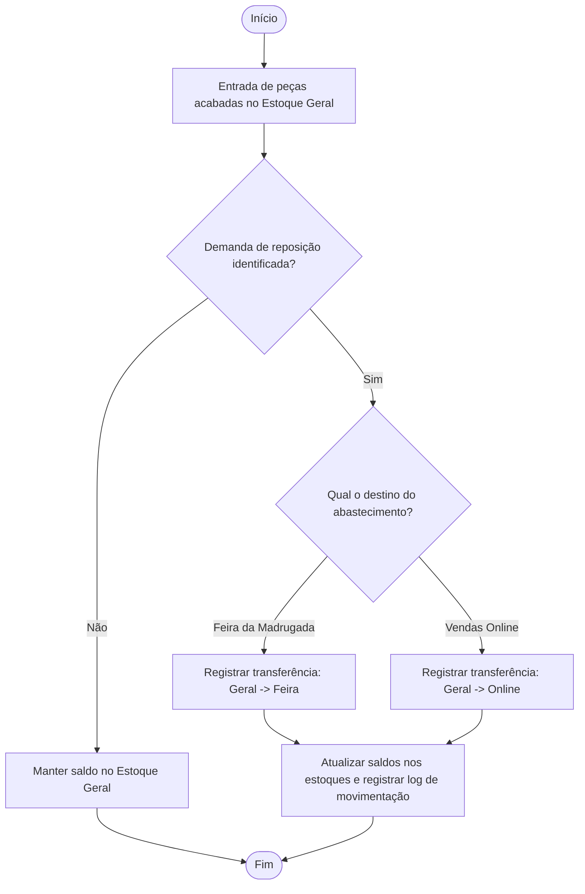
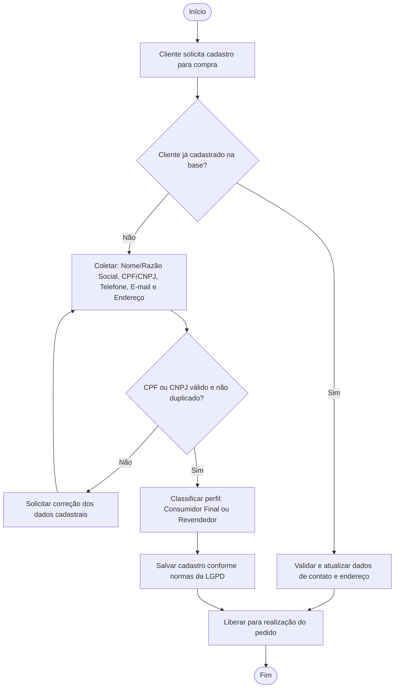
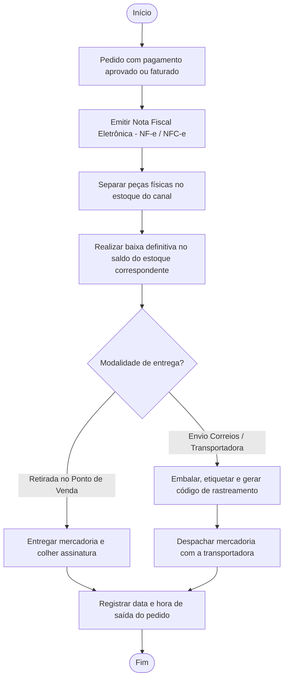
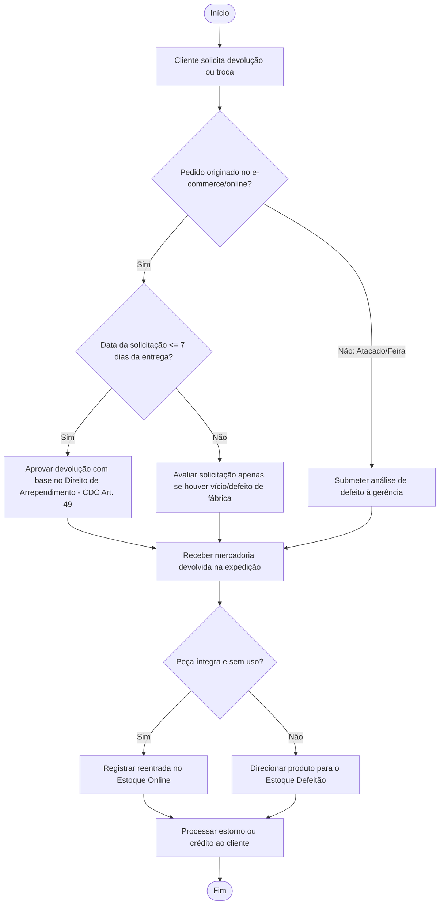
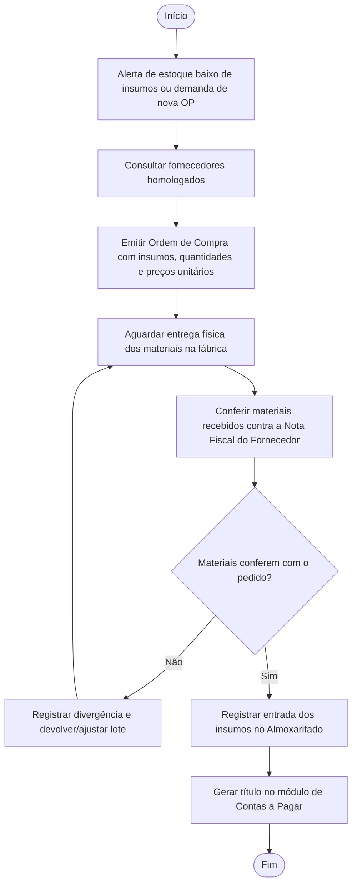

# Entrega 1 — Modelo Conceitual (DER)
### Modelagem de um sistema de gestão de informações para uma organização de pequeno porte

> Este arquivo é o esqueleto do **README.md** do repositório GitHub do seu grupo.
> Preencha cada seção abaixo. Não apague os títulos — apenas substitua as instruções em *itálico* pelo conteúdo do seu projeto.
> O **DER** é anexado separadamente ao repositório (em imagem), mas sua justificativa entra neste README.
>
> **A organização escolhida pode ser de qualquer natureza:** empresa com fins lucrativos (livraria, lanchonete, pet shop), ONG, associação comunitária, cooperativa, instituições religiosas/comunitárias como igrejas, terreiros de religiões de matriz africana (candomblé, umbanda) ou outras. O que muda de um tipo para outro são os processos e as regras específicas — a estrutura do trabalho (levantamento de requisitos, modelagem conceitual, DER) é a mesma para todas. Termos como "empresa" e "negócio" usados abaixo devem ser lidos de forma ampla, no sentido técnico de modelagem de dados (ex.: "regras de negócio" = regras de funcionamento da organização, seja ela comercial, religiosa ou social).
>
> **Importante:** a organização precisa **existir de fato** — não é permitido inventar uma organização fictícia. O levantamento de requisitos e regras de negócio deve ser feito por meio de **pesquisa de campo na própria organização** (visitas, entrevistas com responsáveis, observação dos processos reais), então o grupo só deve escolher uma organização à qual **realmente tenha acesso**. Ao escolher, tomem cuidado com o porte: **nem tão pequena** que não gere dados suficiente para o trabalho (poucos processos, poucas entidades), **nem tão grande/complexa** que fique inviável de modelar nesta primeira etapa do curso.

<!-- Alterar apenas o que tá em italico (o que está entre um único asteristico, ex: *batata doce com abobrinha*. -->

## Metadados

- **Nomes dos alunos e RGM**

| Nome                            | RGM      | 
|---------------------------------|----------|
| Felipe Piazza Bononi            | 47349361 |
| Lucas Fortes de Melo            | 46781977 |
| Vinicius Passos Macedo          | 47116871 |

## 1. Caracterização da Organização
<!-- *(vale 7,5% — Dimensão Conceitual)* -->

- **Nome e natureza da organização:**
  
*A organização escolhida para o desenvolvimento do projeto é a Namiê Brasil Ltda., empresa do segmento de moda feminina, com atuação na fabricação e comercialização de peças de vestuário, especialmente roupas jeans femininas. A empresa possui atuação tanto no comércio atacadista quanto no varejista. Informações públicas cadastrais classificam sua atividade principal como confecção de peças do vestuário, além de atividades de comércio atacadista e varejista de artigos do vestuário.*
  
- **Contexto e porte:**
  
*A Namiê Brasil está localizada no bairro do Brás, em São Paulo – SP, e possui aproximadamente 50 pessoas envolvidas em suas operações. A organização possui diferentes setores, incluindo produção, costura, acabamento, expedição, pontos de venda, e-commerce, financeiro, recursos humanos e diretoria.

A empresa trabalha com fabricação própria de roupas femininas e comercializa seus produtos em diferentes canais. No atacado, as vendas ocorrem presencialmente nos pontos de venda e também por meio do WhatsApp, tendo como público principal as revendedoras. No varejo, as vendas são realizadas por meio do site e de marketplaces, atendendo diretamente consumidores finais.

O processo produtivo envolve a definição do modelo e do tecido, aquisição de matéria-prima quando necessária, corte, costura, lavanderia e acabamento. O acabamento compreende atividades como aplicação de botões, etiquetas, tags e demais aviamentos. Todas as etapas do processo produtivo são realizadas internamente pela própria fábrica.*

- **Problemas e necessidades identificados:**
  
*Durante o levantamento realizado com a organização, foi identificada uma fragmentação no controle das informações de estoque e vendas, que atualmente são distribuídas entre diferentes ferramentas.

O controle de matérias-primas, cortes, costura, acabamento e determinadas movimentações é realizado por meio do sistema Omiê. O controle dos estoques de produtos acabados, incluindo o estoque geral e o estoque destinado à feira, é realizado por meio de planilhas eletrônicas. Já as vendas realizadas pelo site e marketplaces são controladas pelo sistema Bling ERP, que também mantém o estoque destinado às vendas online.

Essa divisão faz com que as informações de estoque não estejam centralizadas em um único sistema. Além disso, as planilhas não são atualizadas necessariamente no momento em que ocorre uma movimentação, podendo ocorrer divergências entre o estoque registrado e a quantidade efetivamente disponível.

Também foi identificado que, em determinadas situações, uma peça pode ser vendida sem que sua disponibilidade seja previamente confirmada, ocasionando a venda de produtos que não estão disponíveis em estoque. Nas vendas realizadas na feira, a baixa das peças pode ocorrer imediatamente ou posteriormente, contribuindo para a possibilidade de divergências no controle.

Outro ponto identificado é a ausência de um estoque mínimo definido, fazendo com que a necessidade de produção ou reposição seja percebida principalmente quando a quantidade disponível se torna insuficiente ou se esgota.*

- **Justificativa da escolha:**
  
*A Namiê Brasil foi escolhida por apresentar uma operação real que envolve diferentes processos relacionados à produção, controle de estoque e comercialização de produtos, proporcionando quantidade e variedade suficientes de informações para a realização da modelagem conceitual.

Além disso, um dos integrantes do grupo possui acesso à organização, permitindo o levantamento de requisitos diretamente com base nos processos reais observados. A existência de diferentes ferramentas utilizadas simultaneamente para controle das operações também proporciona um problema concreto para análise e modelagem de uma possível solução integrada.

O controle de produtos acabados apresenta ainda diferentes características que precisam ser consideradas pelo sistema, como modelo, coleção, cor, tamanho e SKU, além da existência de diferentes locais de estoque e canais de venda.*

- **Evidências da organização:**

*Namiê Brasil possui presença pública na internet por meio de seu site oficial:*

https://www.namiebrasil.com.br/

*E pelo instagram:*

https://www.instagram.com/namiebrasil/

*A empresa está localizada no bairro do Brás, em São Paulo – SP. Informações públicas de cadastro empresarial indicam a sede na Rua Piratininga, 514, conjunto 500, Brás, São Paulo – SP, CEP 03042-000.
Porém, possui 3 lojas físicas.

Vale Ressaltar que Anthony Werick, ex-membro do grupo (acabou fazendo transferencia de matricula para EAD), trabalha na empresa e foi por meio dele que conseguimos contato com a mesma.
namiebrasil@gmail.com

---

## 2. Processos de Negócio
<!-- *(vale 10% — Dimensão Procedimental)* -->

- **Principais processos mapeados:**
  
*A produção inicia-se com a definição do modelo e do tecido pela diretoria. Após verificar a disponibilidade da matéria-prima, o tecido é adquirido quando necessário. Em seguida, o material passa pelas etapas de corte, costura, lavanderia e acabamento, todas realizadas pela própria fábrica. No acabamento são aplicados itens como botões, etiquetas, tags e demais aviamentos. Após a conclusão, as peças são encaminhadas à expedição, que registra a produção e realiza a entrada dos produtos acabados no estoque.*
  
### 2.1 Grupo Vendas
1. **Venda no Atacado (Feira da Madrugada e WhatsApp):**
   - *Descrição:* Atendimento a revendedoras e lojistas que compram para revenda. O cliente escolhe as peças especificando modelo, cor e tamanho. O sistema valida se a quantidade total atinge o lote mínimo exigido para atacado (RN13) e se há saldo disponível no estoque do canal de venda (RN05). Aplica-se o preço de atacado tabelado (RN06). O pedido é registrado com status inicial e segue para conferência de pagamento e separação.
   - *Dados envolvidos:* ID do pedido, data/hora, ID do cliente (revendedora), canal ('Atacado Feira' ou 'Atacado WhatsApp'), lista de itens (SKU, quantidade, preço unitário de atacado), valor total e status do pedido.

2. **Venda no Varejo (Site Oficial e Marketplaces):**
   - *Descrição:* Compra realizada pelo consumidor final por meio da loja virtual ou marketplaces integrados. A consulta de saldo é realizada exclusivamente no Estoque Online. O cliente seleciona os itens por variação (SKU/EAN-13), calcula o frete e realiza o checkout com preço de varejo. O pedido é registrado com status "Aguardando Pagamento".
   - *Dados envolvidos:* ID do pedido, data/hora, canal ('Site' ou 'Marketplace'), ID do cliente, itens do pedido (SKU, quantidade, preço unitário de varejo), endereço de entrega, valor do frete e valor total.

3. **Cadastro de Clientes e Revendedoras:**
   - *Descrição:* Coleta e validação cadastral antes do faturamento do primeiro pedido. O sistema diferencia perfis entre "Consumidor Final" (varejo) e "Revendedora/Lojista" (atacado). São exigidos dados fiscais e de contato obrigatórios. Em conformidade com a LGPD (RN17 / RO06), os dados são protegidos e podem ser anonimizados mediante solicitação, mantendo o histórico fiscal.
   - *Dados envolvidos:* ID do cliente, tipo de cliente ('Consumidor Final' ou 'Revendedor'), nome/razão social, CPF ou CNPJ (único e validado), telefone, e-mail, status de crédito e endereço completo (logradouro, número, complemento, bairro, cidade, UF, CEP).

4. **Recebimento e Pagamento das Vendas:**
   - *Descrição:* Processamento financeiro do pedido. No varejo online, o recebimento ocorre via gateway (cartão de crédito com autorização imediata, Pix com liquidação instantânea ou boleto bancário compensado). No atacado presencial/WhatsApp, o pagamento é feito à vista (Pix, dinheiro ou cartão). A venda a prazo (boleto faturado ou parcelado em até 3x) é autorizada exclusivamente para revendedoras previamente cadastradas com análise de crédito aprovada pela gerência (RN14).
   - *Dados envolvidos:* ID do pagamento/parcela, ID do pedido, valor da parcela, forma de pagamento ('Pix', 'Cartao_Credito', 'Cartao_Debito', 'Boleto', 'Dinheiro'), data de vencimento, data de liquidação e situação ('Pendente', 'Pago', 'Cancelado').

5. **Separação, Emissão de Nota Fiscal e Expedição:**
   - *Descrição:* Após a confirmação do pagamento (ou liberação de prazo pela gerência), o pedido entra em separação (picking) no estoque físico correspondente (Online, Feira ou Geral). É emitida a Nota Fiscal Eletrônica (NF-e/NFC-e) vinculada ao pedido (RN15 / RO04). Com a emissão fiscal, é efetuada a baixa definitiva de estoque. A mercadoria é embalada e despachada para retirada presencial ou entrega via Correios/transportadora com código de rastreio.
   - *Dados envolvidos:* ID da nota fiscal, ID do pedido, número da NF, série, chave de acesso (44 dígitos), data de emissão, valor fiscal, código de rastreio, transportadora e data de envio.

6. **Devoluções e Trocas (Online e Presencial):**
   - *Descrição:* Atendimento pós-venda. No e-commerce, o consumidor possui direito de arrependimento de até 7 dias corridos após a entrega confirmada (RN16 / RO05) ou devolução por defeito no prazo de garantia. No atacado/feira, trocas ocorrem apenas mediante autorização da gerência por defeito de fábrica comprovado. As peças devolvidas passam por inspeção: peças perfeitas retornam ao estoque comercializável (RN11), enquanto peças avariadas ou com vício são destinadas ao "Defeitão" (RN10).
   - *Dados envolvidos:* ID da devolução, ID do pedido original, SKU, quantidade, motivo da devolução, condição da peça ('Perfeita' ou 'Defeituosa'), data da solicitação, data de entrega do pedido e estoque de destino ('Online' ou 'Defeitão').

### 2.2 Grupo Compras e Suprimentos
7. **Compra de Matéria-Prima (Tecidos e Aviamentos):**
   - *Descrição:* Aquisição de insumos necessários para a fabricação (rolos de tecido jeans denim, sarja, botões de latão, zíperes de metal, rebites, linhas de pesponto, tags de marca e etiquetas de composição). O almoxarife/comprador emite a Ordem de Compra vinculada a um fornecedor homologado. Na entrega, o material é conferido fisicamente contra o documento fiscal (DANFE) e gera a entrada no estoque de matérias-primas e o lançamento em Contas a Pagar.
   - *Dados envolvidos:* ID da compra, ID do fornecedor, número do documento fiscal, data da compra, data de entrega, itens de insumo (ID do insumo, unidade de medida, quantidade comprada, valor unitário) e valor total.

8. **Cadastro e Gestão de Fornecedores:**
   - *Descrição:* Homologação de parceiros comerciais de suprimentos. Registra empresas fornecedoras de tecidos planos, aviamentos metálicos, químicos para lavanderia e embalagens. Permite acompanhar histórico de compras e condições de fornecimento.
   - *Dados envolvidos:* ID do fornecedor, razão social, nome fantasia, CNPJ (único e validado), inscrição estadual, telefone, e-mail do setor comercial, contato do representante e endereço completo.

9. **Contas a Pagar:**
   - *Descrição:* Controle financeiro dos compromissos da confecção originados das compras de insumos e matérias-primas. Cada compra faturada gera um ou mais títulos a pagar com vencimentos predefinidos. O setor financeiro realiza o acompanhamento diário, efetua o pagamento na data acordada e registra a quitação.
   - *Dados envolvidos:* ID do título a pagar, ID da compra, ID do fornecedor, valor da obrigação, data de emissão, data de vencimento, data de pagamento efetivo, forma de pagamento e status ('Aberto', 'Liquidado', 'Vencido').

### 2.3 Grupo Produção
10. **Produção Própria (Corte, Costura, Lavanderia e Acabamento):**
    - *Descrição:* A diretoria define os modelos da coleção. Após confirmação da disponibilidade de tecido e aviamentos, abre-se uma Ordem de Produção (OP) discriminando os SKUs e quantidades a produzir. As etapas ocorrem 100% na fábrica própria: enfestamento e corte do tecido, montagem e costura nas máquinas industriais, lavanderia e estonagem, e acabamento (caseamento, aplicação de botões/rebites, etiquetagem e passadoria). As peças aprovadas no controle de qualidade são enviadas à expedição para entrada no Estoque Geral (RN08 / RN09).
    - *Dados envolvidos:* ID da ordem de produção, data de início, data de previsão, data de término, status da OP ('Planejada', 'Em Corte', 'Em Costura', 'Em Lavanderia', 'Em Acabamento', 'Concluída'), itens produzidos (SKU e quantidade aprovada).

### 2.4 Grupo Apoio e Estoque
11. **Controle de Estoque e Transferência entre Locais:**
    - *Descrição:* Gestão física e lógica dos saldos de cada SKU nos 4 estoques da empresa: Estoque Geral (Fábrica), Estoque Feira (Ponto de venda físico), Estoque Online (E-commerce) e Estoque Defeitão. Quando a feira ou o e-commerce precisam de reposição, realiza-se uma Transferência formal, abatendo a quantidade do Estoque Geral de origem e somando ao estoque de destino de forma atômica (RN03 / RN04). O sistema monitora o ponto de pedido através do Estoque Mínimo por SKU (RN12).
    - *Dados envolvidos:* ID da movimentação, tipo ('Entrada', 'Saída', 'Transferência'), SKU, ID do estoque de origem, ID do estoque de destino, quantidade movimentada, data/hora do registro e usuário responsável.

12. **Tratamento de Defeitos ("Defeitão"):**
    - *Descrição:* Segregação obrigatória de peças com avarias de corte/costura, manchas irreversíveis de lavanderia, peças danificadas no manuseio da feira ou produtos devolvidos com dano pelo cliente. Essas peças são retiradas do estoque vendável e alocadas no estoque "Defeitão", impedindo sua comercialização nos canais regulares e viabilizando eventual descarte, reaproveitamento ou venda em bazares de peças não conformes (RN10).
    - *Dados envolvidos:* ID da movimentação, SKU, quantidade avariada, motivo do defeito, data de descarte/segregação e estoque destino ('Defeitão').
  
- **Fluxogramas:** 
### 2.5 Fluxogramas dos processos

Os fluxogramas representam os processos observados durante o levantamento e a forma como esses processos poderão ser organizados e controlados pelo sistema proposto.

#### 2.5.1 Produção de Peças

#### 2.5.2 Abastecimento e Transferência de Estoque

#### 2.5.3 Tratamento de Defeitos e Peças Não Conformes ("Defeitão")

#### 2.5.4 Venda no Atacado (Feira e WhatsApp)

#### 2.5.5 Venda no Varejo (Site e Marketplaces)

#### 2.5.6 Cadastro de Clientes e Revendedoras

#### 2.5.7 Recebimento e Pagamento das Vendas

#### 2.5.8 Separação, Emissão de Nota Fiscal e Expedição

#### 2.5.9 Devoluções e Direito de Arrependimento (CDC)

#### 2.5.10 Cadastro e Gestão de Fornecedores

#### 2.5.11 Compra de Matéria-Prima (Tecidos e Aviamentos)

#### 2.5.12 Gestão de Contas a Pagar

---
## 3. Requisitos do Sistema
<!-- *(esta seção e a Seção 4 "Regras de Negócio" DIVIDEM 7,5% na dimensão conceitual — juntas valem 7,5%, não 7,5% cada — + 4% exclusivos desta seção na organização/documentação)* -->

### 3.1 Requisitos Funcionais
<!-- *O que o sistema precisa FAZER (ex.: "o sistema deve permitir registrar uma venda").* -->
| ID | Requisito Detalhado com Dados Envolvidos |
|---|---|
| **RF01** | O sistema deve permitir cadastrar e consultar produtos/modelos com ID do produto, nome comercial, descrição detalhada e associação à coleção. |
| **RF02** | O sistema deve permitir cadastrar as variações de cada modelo com ID da variação, modelo vinculado, cor, tamanho e código SKU exclusivo. |
| **RF03** | O sistema deve permitir cadastrar e gerenciar coleções com ID da coleção, nome da coleção, ano/temporada e cartela de cores. |
| **RF04** | O sistema deve permitir cadastrar e consultar clientes com ID do cliente, tipo ('Consumidor Final' ou 'Revendedor'), nome/razão social, CPF/CNPJ validado e único, telefone, e-mail e endereço completo (logradouro, número, complemento, bairro, cidade, UF, CEP). |
| **RF05** | O sistema deve permitir registrar pedidos de venda no atacado vinculando cliente revendedor, data/hora, canal ('Atacado Feira' ou 'Atacado WhatsApp'), itens (SKU, quantidade, preço unitário de atacado) e valor total. |
| **RF06** | O sistema deve permitir registrar pedidos de venda no varejo vinculando cliente, data/hora, canal ('Site' ou 'Marketplace'), itens (SKU, quantidade, preço unitário de varejo), frete e valor total. |
| **RF07** | O sistema deve permitir adicionar, alterar e remover itens do pedido, recalculando automaticamente o valor total e preservando o preço unitário histórico praticado no momento da venda. |
| **RF08** | O sistema deve permitir consultar a disponibilidade física e lógica de cada SKU em cada localização de estoque (Geral, Feira, Online e Defeitão). |
| **RF09** | O sistema deve permitir registrar entradas e saídas de estoque com ID da movimentação, tipo ('Entrada', 'Saida'), SKU, estoque envolvido, quantidade, data/hora e justificativa. |
| **RF10** | O sistema deve permitir registrar transferências de estoque entre locais (Geral para Feira, Geral para Online), reduzindo o saldo da origem e aumentando o do destino de forma atômica e rastreada. |
| **RF11** | O sistema deve permitir segregar e transferir peças defeituosas, amostras danificadas ou itens devolvidos com avaria para o estoque "Defeitão", impedindo sua exibição no estoque vendável. |
| **RF12** | O sistema deve permitir registrar ordens de produção (OP) com ID da ordem, data de início, data de término prevista, data de conclusão real e status da produção. |
| **RF13** | O sistema deve permitir associar as quantidades produzidas na OP às respectivas variações/SKUs de produtos acabados. |
| **RF14** | O sistema deve permitir registrar a entrada das peças acabadas aprovadas pela expedição diretamente no Estoque Geral da fábrica após a conclusão da OP. |
| **RF15** | O sistema deve permitir consultar o histórico completo de movimentações de estoque por SKU, período, tipo de operação e estoque. |
| **RF16** | O sistema deve permitir consultar pedidos de venda por cliente, período, canal, status do pedido e status de faturamento. |
| **RF17** | O sistema deve diferenciar as tabelas de preços praticadas, associando a cada modelo o preço de atacado e o preço de varejo. |
| **RF18** | O sistema deve permitir identificar e filtrar as operações por canal de venda (Feira, WhatsApp, Site, Marketplace). |
| **RF19** | O sistema deve permitir cadastrar e monitorar a quantidade de **estoque mínimo por SKU** no Estoque Geral, gerando alerta de reposição preventiva quando o saldo for menor ou igual ao mínimo. |
| **RF20** | O sistema deve validar a **quantidade mínima total de peças** em pedidos de atacado, impedindo a finalização de pedidos atacadistas abaixo da cota estipulada pela empresa. |
| **RF21** | O sistema deve registrar as **formas de pagamento** (Pix, Dinheiro, Cartão, Boleto) e controlar parcelas com valores e datas de vencimento para vendas a prazo a revendedoras cadastradas. |
| **RF22** | O sistema deve registrar e vincular a **Nota Fiscal Eletrônica (NF-e/NFC-e)** a cada pedido faturado, contendo número da nota, série, chave de acesso de 44 dígitos, data de emissão e valor total fiscal. |
| **RF23** | O sistema deve permitir registrar **devoluções de vendas**, capturando pedido de origem, SKU, quantidade, motivo, condição da peça e validando o prazo legal de 7 dias do CDC para compras online. |
| **RF24** | O sistema deve permitir cadastrar e consultar **fornecedores de matéria-prima** com razão social, nome fantasia, CNPJ validado e único, inscrição estadual, telefone, e-mail e endereço. |
| **RF25** | O sistema deve permitir registrar **compras de matéria-prima e aviamentos** com ID da compra, fornecedor, número do documento fiscal, data, itens adquiridos (insumo, unidade, quantidade, preço unitário) e valor total. |
| **RF26** | O sistema deve permitir gerenciar **contas a pagar** vinculadas às compras de matérias-primas, contendo valor, data de emissão, data de vencimento, data de liquidação e situação do pagamento. |
| **RF27** | O sistema deve permitir a **anonimização de dados de clientes** conforme a LGPD, substituindo dados identificadores a pedido do titular, mantendo preservados os registros fiscais e contábeis obrigatórios. |

### 3.2 Requisitos Não Funcionais
<!-- *Características de qualidade (ex.: desempenho, segurança, usabilidade, disponibilidade).* -->
| ID | Requisito Não Funcional |
|---|---|
| **RNF01** | **Usabilidade:** A interface do sistema deve ser objetiva e intuitiva, possibilitando a operação ágil por funcionários de chão de fábrica, vendedores de feira e operadores de expedição. |
| **RNF02** | **Segurança e Acesso:** Os dados confidenciais de clientes, custos de produção e financeiro devem possuir controle de acesso baseado em perfis/papéis (RBAC). |
| **RNF03** | **Auditoria e Rastreabilidade:** O banco de dados deve manter histórico imutável de todas as movimentações de estoque, pedidos faturados e transações financeiras. |
| **RNF04** | **Desempenho:** As consultas de disponibilidade de estoque por SKU e localização devem responder em tempo inferior a 2 segundos em situações de alta concorrência. |
| **RNF05** | **Confiabilidade e Backup:** O sistema deve dispor de rotinas automatizadas de backup periódico e recuperação contra desastres para garantir a integridade dos dados operacionais. |
| **RNF06** | **Integridade Referencial e Transacional:** O banco de dados deve utilizar transações ACID para garantir que movimentações de estoque, faturamentos e pagamentos ocorram de forma atômica e consistente. |
| **RNF07** | **Concorrência:** O banco de dados deve suportar acessos simultâneos de múltiplos usuários operando vendas na feira, e-commerce, almoxarifado e fábrica sem travamentos ou condições de corrida. |
| **RNF08** | **Conformidade Legal e Regulatória:** O armazenamento e processamento de informações devem cumprir a legislação fiscal brasileira (NF-e/SEFAZ), o Código de Defesa do Consumidor (CDC) e a LGPD (Lei nº 13.709/2018). |
                                                            

---

## 4. Regras de Negócio
*(esta seção DIVIDE com a Seção 3 "Requisitos do Sistema" os mesmos 7,5% da dimensão conceitual — juntas valem 7,5%, não 7,5% cada — + 4% exclusivos desta seção na documentação. "Regras de negócio" é o termo técnico usado em modelagem de dados para as regras de funcionamento de qualquer organização, com ou sem fins lucrativos)*
- **Regras operacionais:**
*condições que a organização impõe (ex.: "um pedido só pode ser fechado se houver estoque disponível", "uma doação só pode ser registrada com identificação do doador", "um ritual só pode ser agendado se o espaço estiver disponível").*
  
- **RN01 — Identificação de produtos e variações (SKU):**  
  Todo produto fabricado ou comercializado deve ser modelado com base na combinação de modelo, cor e tamanho, gerando um código SKU único para cada variação física da peça.
- **RN02 — Associação entre produto e coleção:**  
  Cada produto/modelo pertence a uma coleção específica, sendo a coleção associada à temporada e à paleta de cores desenvolvida pela confecção.
- **RN03 — Controle de estoque por localização/canal:**  
  Os produtos acabados devem ter saldos gerenciados de forma individualizada de acordo com o local de armazenagem: Estoque Geral (Fábrica), Estoque Feira (Ponto de venda presencial), Estoque Online (E-commerce) e Estoque Defeitão (Não conformes).
- **RN04 — Transferência controlada entre estoques:**  
  Toda transferência de peças (ex.: Geral para Feira ou Geral para Online) exige registro formal da movimentação, abatendo o saldo do estoque de origem e adicionando ao estoque de destino de forma síncrona.
- **RN05 — Disponibilidade prévia para venda:**  
  Um item só pode ser vendido se houver saldo positivo disponível no estoque específico do canal em que o pedido está sendo gerado (Estoque Online para site/marketplaces; Estoque Feira para vendas na feira).
- **RN06 — Diferenciação de preços atacado e varejo:**  
  Cada produto/modelo possui tabela de preços distinta, garantindo que compras no atacado utilizem o valor de atacado e compras no e-commerce utilizem o valor de varejo.
- **RN07 — Composição e integridade do pedido:**  
  Todo pedido de venda deve estar obrigatoriamente vinculado a um cliente cadastrado e conter pelo menos um item. Cada item registra o SKU, a quantidade vendida e o preço unitário praticado no momento da venda (imutável historicamente).
- **RN08 — Registro detalhado de produção por variação:**  
  Toda produção fabril deve ser controlada por Ordem de Produção (OP), especificando com exatidão a quantidade produzida por SKU.
- **RN09 — Entrada de produtos acabados no estoque geral:**  
  Ao ser finalizada e inspecionada pela expedição, a produção aprovada deve ser automaticamente lançada como entrada de saldo no Estoque Geral da fábrica.
- **RN10 — Segregação de produtos defeituosos ("Defeitão"):**  
  Peças reprovadas no controle de qualidade, danificadas em transporte/feira ou devolvidas com defeito devem ser transferidas para o estoque "Defeitão", ficando bloqueadas para venda convencional.
- **RN11 — Retorno de devoluções íntegras ao estoque:**  
  Peças devolvidas de vendas online que passarem por inspeção e apresentarem condições intactas de comercialização devem retornar ao saldo do Estoque Online.
- **RN12 — Controle de estoque mínimo por SKU (Reposição preventiva):**  
  Cada variação/SKU deve possuir uma quantidade mínima estipulada para o Estoque Geral (`estoque_minimo`). Quando o saldo atingir valor menor ou igual ao mínimo, o sistema deve emitir alerta gerencial de reposição para evitar rupturas de estoque.
- **RN13 — Quantidade mínima de peças no atacado (Pedido mínimo):**  
  Pedidos realizados no canal de atacado (Feira e WhatsApp) devem respeitar uma quantidade mínima total de peças por pedido (definida pela gerência, ex.: mínimo de 12 peças no total), condição obrigatória para aplicação do preço atacadista.
- **RN14 — Formas e condições de pagamento:**  
  Todo pedido deve ter sua condição de pagamento registrada. Vendas online exigem liquidação prévia via gateway. Vendas no atacado são realizadas à vista (Pix, dinheiro, débito) ou a prazo (boleto parcelado), sendo o prazo concedido unicamente a revendedoras cadastradas e homologadas com limite de crédito liberado pela gerência.
- **RN15 — Emissão obrigatória de Nota Fiscal Eletrônica (NF-e/NFC-e):**  
  Todo pedido faturado deve ter emitida a respectiva nota fiscal antes da liberação e expedição da mercadoria, armazenando número, série, chave de acesso de 44 dígitos, data de emissão e valor total fiscal vinculado ao pedido.
- **RN16 — Direito de arrependimento em até 7 dias nas vendas online (CDC):**  
  Nas compras efetuadas fora do estabelecimento físico (site e marketplaces), o consumidor pode solicitar a devolução dos produtos em até 7 dias corridos após o recebimento comprovado da mercadoria, sem ônus ou justificativa de vício.
- **RN17 — Proteção e privacidade de dados pessoais (LGPD):**  
  Os dados pessoais coletados de clientes e revendedoras (CPF, e-mail, telefone, endereço) destinam-se exclusivamente ao processamento dos pedidos, entrega e obrigações fiscais. É garantido o direito de anonimização do cadastro a pedido do titular, preservando os registros fiscais legalmente exigidos.
- **RN18 — Cadastro e homologação de fornecedores:**  
  Toda aquisição de matéria-prima (tecidos e aviamentos) deve ser vinculada a um fornecedor previamente cadastrado e ativo com CNPJ regular.
- **RN19 — Vínculo de compras ao contas a pagar:**  
  Toda compra de matéria-prima gera automaticamente uma obrigação financeira no módulo de Contas a Pagar com datas de vencimento, valores e controle de quitação.
  
### 4.2 Restrições Organizacionais, Legais e Fiscais
*limitações que afetam o modelo (ex.: políticas internas, prazos, exigências legais, normas religiosas ou estatutárias) — e por que elas importam.*

- **RO01 — Segregação de estoques por localização e canal (Restrição Organizacional):**  
  A organização opera estoques físicos descentralizados (Geral, Feira, Online e Defeitão). O modelo deve suportar saldos independentes por SKU em cada localização.
- **RO02 — Integração e centralização de sistemas legados (Restrição Tecnológica):**  
  A organização utiliza múltiplos softwares (Omiê, Bling e planilhas). O banco de dados modelado deve centralizar as entidades fundamentais da empresa para eliminar inconsistências.
- **RO03 — Fabricação própria verticalizada (Restrição Operacional):**  
  As etapas fabris de corte, costura, lavanderia e acabamento são realizadas 100% internamente. A entidade ORDEM_PRODUÇÃO reflete o controle interno da manufatura.
- **RO04 — Obrigatoriedade de documento fiscal (Restrição Fiscal — Legislação Tributária / SEFAZ):**  
  Exigência da legislação tributária brasileira para circulação de mercadorias no atacado e varejo. O sistema deve registrar os metadados da NF-e para conformidade fiscal.
- **RO05 — Direito de arrependimento no e-commerce (Restrição Legal — CDC, Lei nº 8.078/1990, Art. 49):**  
  Exigência legal de concessão do prazo de 7 dias para desistência de compra online. O modelo armazena a data de entrega e a data de solicitação da devolução para comprovar o prazo legal.
- **RO06 — Proteção de dados pessoais (Restrição Legal — LGPD, Lei nº 13.709/2018):**  
  Norma legal de tratamento e proteção de dados de clientes, prevendo minimização de dados, controle de acesso restrito e procedimento de anonimização.
- **RO07 — Política de concessão de crédito no atacado (Restrição Financeira / Organizacional):**  
  A concessão de venda a prazo para revendedoras é restrita à aprovação gerencial e limite de crédito prévio, visando conter riscos de inadimplência.

---

## 5. Dicionário de Dados Conceitual (Preliminar)
<!-- *(vale 10% — Dimensão Procedimental)* -->
Para cada entidade identificada, liste:

| Atributo | Descrição | Regra de negócio associada |
|----------|-----------|------------------------------|
| *nome do atributo* | *o que ele representa* | *se houver alguma regra (obrigatoriedade, valores possíveis, etc.)* |

*Mantenha o dicionário organizado e padronizado (mesmo formato de tabela para todas as entidades).*

**Atenção à privacidade:** se forem usados exemplos de valores para ilustrar os atributos, esses exemplos devem ser **fictícios** — não utilize dados reais de clientes, fiéis, beneficiários, doadores ou funcionários da organização (nomes, CPFs, contatos etc.), mesmo que tenham sido observados durante a pesquisa de campo. Os exemplos devem apenas ser **coerentes com as operações reais** observadas.

**COLEÇÃO**
| Atributo | Descrição | Regra de negócio associada |
| --- | --- | --- |
| id_colecao | Identificador da coleção | Deve identificar unicamente cada coleção |
| nome | Nome da coleção | Deve permitir identificar a coleção |
| tipo | Classificação da coleção | Pode representar coleção normal, especial ou de linha permanente |
| ano_temporada | Ano ou temporada de referência | Associa a coleção à temporada em que foi desenvolvida (RF03, RN02) |
| cartela_cores | Paleta de cores da coleção | Orienta a associação dos produtos à coleção (RF03, RN02) |

**PRODUTO/MODELO**
| Atributo | Descrição | Regra de negócio associada |
| --- | --- | --- |
| id_produto | Identificador do modelo do produto | Deve identificar unicamente cada modelo |
| nome | Nome do modelo do produto | Obrigatório |
| descricao | Descrição do modelo | Pode ser utilizada para detalhar o produto |
| id_colecao | Coleção relacionada | O produto deve estar associado a uma coleção |

**VARIAÇÃO/SKU**
| Atributo | Descrição | Regra de negócio associada |
| --- | --- | --- |
| id_variacao | Identificador da variação | Deve identificar unicamente a variação |
| sku | Código de identificação da variação | Cada combinação de modelo, cor e tamanho possui um SKU único |
| cor | Cor da peça | Obrigatória |
| tamanho | Tamanho da peça | Obrigatório |
| estoque_minimo | Quantidade mínima desejada no Estoque Geral | Saldo menor ou igual ao mínimo gera alerta de reposição (RN12) |
| id_produto | Produto/modelo ao qual pertence | Toda variação deve pertencer a um modelo |

**PREÇO**
| Atributo | Descrição | Regra de negócio associada |
| --- | --- | --- |
| id_preco | Identificador do preço | Deve identificar unicamente o registro de preço |
| preco_atacado | Preço praticado no atacado | Valor utilizado nas vendas de atacado |
| preco_varejo | Preço praticado no varejo | Valor utilizado nas vendas de varejo; maior ou igual ao de atacado |
| id_produto | Modelo relacionado | Cada registro de preço está associado a um único produto/modelo |

**ESTOQUE**
| Atributo | Descrição | Regra de negócio associada |
| --- | --- | --- |
| id_estoque | Identificador do estoque | Deve identificar unicamente cada estoque |
| localizacao | Local ou finalidade do estoque | Deve diferenciar, no mínimo, geral, feira, online e defeitão |

**Relacionamento VARIAÇÃO/SKU ↔ ESTOQUE (N:N)**

Uma variação pode ter saldo em vários estoques, e um estoque pode conter várias variações. O relacionamento carrega o atributo:

| Atributo | Descrição | Regra de negócio associada |
| --- | --- | --- |
| quantidade | Quantidade disponível da variação naquele estoque | Maior ou igual a zero |

**MOVIMENTAÇÃO DE ESTOQUE**
| Atributo | Descrição | Regra de negócio associada |
| --- | --- | --- |
| id_movimentacao | Identificador da movimentação | Deve identificar unicamente cada movimentação |
| tipo | Tipo da movimentação | Entrada, saída ou transferência |
| quantidade | Quantidade movimentada | Maior que zero |
| data_hora | Data e horário da movimentação | Registra quando a movimentação ocorreu |
| justificativa | Motivo da movimentação | Registra a justificativa de entradas, saídas e ajustes (RF09) |
| id_estoque_origem | Estoque de origem | Informado em saídas e transferências |
| id_estoque_destino | Estoque de destino | Informado em entradas e transferências |
| id_variacao | Variação movimentada | Toda movimentação se refere a uma variação/SKU |
| id_usuario | Usuário responsável | Registrado para auditoria (RNF03) |

**USUÁRIO**
| Atributo | Descrição | Regra de negócio associada |
| --- | --- | --- |
| id_usuario | Identificador do usuário | Deve identificar unicamente cada usuário |
| nome | Nome do usuário | Obrigatório |
| perfil | Perfil de acesso | Define as permissões de acesso (RNF02) |
| ativo | Indica se o usuário está habilitado | Usuários inativos não registram novas operações |
| login | Identificador de acesso | Único |
| senha_hash | Hash da senha | Nunca armazenar a senha em texto puro |

**ORDEM DE PRODUÇÃO**
| Atributo | Descrição | Regra de negócio associada |
| --- | --- | --- |
| id_ordem | Identificador da ordem de produção | Deve identificar unicamente cada ordem |
| data_inicio | Data de início da produção | Registra o início da ordem |
| data_prevista | Data prevista de conclusão | Permite acompanhar prazos (RF12) |
| data_fim | Data de conclusão da produção | Preenchida quando a produção for concluída |
| status | Situação da ordem | Planejada, em corte, em costura, em lavanderia, em acabamento ou concluída |

**Relacionamento VARIAÇÃO/SKU ↔ ORDEM DE PRODUÇÃO (N:N)**

Uma ordem pode produzir várias variações, e uma variação pode ser produzida em várias ordens. O relacionamento carrega o atributo:

| Atributo | Descrição | Regra de negócio associada |
| --- | --- | --- |
| quantidade | Quantidade produzida | Maior que zero (RN08) |

**CLIENTE**
| Atributo | Descrição | Regra de negócio associada |
| --- | --- | --- |
| id_cliente | Identificador do cliente | Deve identificar unicamente cada cliente |
| nome | Nome ou razão social | Obrigatório |
| tipo | Tipo de cliente | Consumidor final ou revendedor |
| documento | CPF ou CNPJ | Único e validado (RF04) |
| telefone | Telefone de contato | Obrigatório |
| email | E-mail do cliente | Obrigatório |
| status_credito | Situação de crédito | Venda a prazo somente a revendedoras homologadas (RN14) |
| limite_credito | Limite de crédito liberado | Definido pela gerência (RO07) |
| logradouro, numero, complemento, bairro, cidade, uf, cep | Endereço completo do cliente | Obrigatório, exceto complemento (RF04) |
| anonimizado | Indica se os dados foram anonimizados | Atende ao direito de anonimização (RN17, RF27) |

**PEDIDO**
| Atributo | Descrição | Regra de negócio associada |
| --- | --- | --- |
| id_pedido | Identificador do pedido | Deve identificar unicamente cada pedido |
| data_hora | Data e horário do pedido | Registra quando o pedido foi realizado |
| canal | Canal de venda | Atacado Feira, Atacado WhatsApp, Site ou Marketplace (RF18) |
| status | Situação do pedido | Permite consultar pedidos por situação (RF16) |
| valor_frete | Valor do frete | Aplicável ao varejo (RF06) |
| valor_total | Valor total do pedido | Recalculado a partir dos itens (RF07) |
| endereco_entrega | Endereço de entrega | Obrigatório nas vendas de varejo com envio |
| data_envio, codigo_rastreio, transportadora | Dados da expedição | Preenchidos após o envio |
| data_entrega | Data da entrega confirmada | Base do prazo de 7 dias para devolução (RN16, RO05) |
| id_cliente | Cliente relacionado | Todo pedido deve estar associado a um cliente |

**Relacionamento VARIAÇÃO/SKU ↔ PEDIDO (N:N)**

Um pedido pode conter várias variações, e uma variação pode aparecer em vários pedidos. O relacionamento carrega os atributos:

| Atributo | Descrição | Regra de negócio associada |
| --- | --- | --- |
| quantidade | Quantidade solicitada | Maior que zero (RN05) |
| preco_unitario | Preço unitário aplicado | Considera o tipo de venda e permanece inalterado após a venda (RN07) |

**PAGAMENTO**
| Atributo | Descrição | Regra de negócio associada |
| --- | --- | --- |
| id_pagamento | Identificador do pagamento/parcela | Deve identificar unicamente cada parcela |
| numero_parcela | Número da parcela | Até 3 parcelas (RN14) |
| valor_parcela | Valor da parcela | Maior que zero |
| forma_pagamento | Forma de pagamento | Pix, cartão de crédito, cartão de débito, boleto ou dinheiro (RF21) |
| data_vencimento | Data de vencimento | Obrigatória |
| data_liquidacao | Data de liquidação | Preenchida quando a parcela for paga |
| situacao | Situação da parcela | Pendente, pago ou cancelado |
| id_pedido | Pedido pago | Todo pedido tem condição de pagamento registrada (RN14) |

**NOTA FISCAL**
| Atributo | Descrição | Regra de negócio associada |
| --- | --- | --- |
| id_nota_fiscal | Identificador da nota fiscal | Deve identificar unicamente cada nota |
| numero, serie | Número e série da nota | Obrigatórios |
| chave_acesso | Chave de acesso | 44 dígitos e única (RN15) |
| data_emissao | Data de emissão | Anterior à expedição da mercadoria (RN15) |
| valor_fiscal | Valor total fiscal | Maior que zero |
| id_pedido | Pedido faturado | Uma nota por pedido faturado (RO04) |

**DEVOLUÇÃO**
| Atributo | Descrição | Regra de negócio associada |
| --- | --- | --- |
| id_devolucao | Identificador da devolução | Deve identificar unicamente cada devolução |
| data_solicitacao | Data da solicitação | Até 7 dias após a entrega nas vendas online (RN16) |
| motivo | Motivo da devolução | Obrigatório |
| id_pedido | Pedido de origem | Toda devolução se refere a um pedido já entregue |

**Relacionamento VARIAÇÃO/SKU ↔ DEVOLUÇÃO (N:N)**

Uma devolução pode envolver várias variações, e uma variação pode ser devolvida em várias devoluções. O relacionamento carrega os atributos:

| Atributo | Descrição | Regra de negócio associada |
| --- | --- | --- |
| quantidade | Quantidade devolvida | Maior que zero; não excede a quantidade vendida |
| condicao_peca | Condição da peça | Perfeita ou defeituosa |
| estoque_destino | Estoque para onde a peça retorna | Online (perfeita, RN11) ou Defeitão (defeituosa, RN10) |

**FORNECEDOR**
| Atributo | Descrição | Regra de negócio associada |
| --- | --- | --- |
| id_fornecedor | Identificador do fornecedor | Deve identificar unicamente cada fornecedor |
| razao_social, nome_fantasia | Identificação do fornecedor | Razão social obrigatória |
| cnpj | CNPJ do fornecedor | Único e validado (RN18, RF24) |
| inscricao_estadual | Inscrição estadual | Quando aplicável |
| telefone, email, contato_representante | Contatos do fornecedor | Telefone e e-mail obrigatórios |
| categoria_insumo | Categoria dos insumos fornecidos | Tecidos, aviamentos, químicos ou embalagens |
| logradouro, numero, complemento, bairro, cidade, uf, cep | Endereço do fornecedor | Obrigatório, exceto complemento |
| ativo | Indica se o fornecedor está ativo | Só fornecedores ativos recebem compras (RN18) |

**INSUMO**
| Atributo | Descrição | Regra de negócio associada |
| --- | --- | --- |
| id_insumo | Identificador do insumo | Deve identificar unicamente cada insumo |
| nome | Nome do insumo | Obrigatório |
| tipo | Classificação do insumo | Tecido, aviamento, químico ou embalagem |
| unidade_medida | Unidade de medida | Obrigatória |

**COMPRA**
| Atributo | Descrição | Regra de negócio associada |
| --- | --- | --- |
| id_compra | Identificador da compra | Deve identificar unicamente cada compra |
| numero_documento_fiscal | Número do documento fiscal do fornecedor | Usado na conferência do recebimento |
| data_compra | Data da compra | Obrigatória |
| data_entrega | Data de entrega dos materiais | Preenchida após o recebimento |
| valor_total | Valor total da compra | Maior que zero |
| id_fornecedor | Fornecedor da compra | Fornecedor cadastrado e ativo (RN18) |

**Relacionamento COMPRA ↔ INSUMO (N:N)**

Uma compra pode incluir vários insumos, e um insumo pode estar em várias compras. O relacionamento carrega os atributos:

| Atributo | Descrição | Regra de negócio associada |
| --- | --- | --- |
| quantidade | Quantidade comprada | Maior que zero; admite fração |
| valor_unitario | Valor unitário pago | Maior que zero (RF25) |

**CONTA A PAGAR**
| Atributo | Descrição | Regra de negócio associada |
| --- | --- | --- |
| id_conta_pagar | Identificador do título | Deve identificar unicamente cada título |
| valor | Valor da obrigação | Maior que zero |
| data_emissao, data_vencimento | Datas do título | Vencimento não anterior à emissão |
| data_pagamento | Data do pagamento efetivo | Preenchida na liquidação |
| forma_pagamento | Forma de pagamento do título | Registrada na quitação |
| status | Situação do título | Aberto, liquidado ou vencido |
| id_compra | Compra que originou o título | Toda compra gera ao menos um título (RN19) |

**LOG DE ACESSO**
| Atributo | Descrição | Regra de negócio associada |
| --- | --- | --- |
| id_log | Identificador do registro | Deve identificar unicamente cada registro |
| id_usuario | Usuário que realizou a operação | Obrigatório |
| data_hora | Data e hora da operação | Preenchida automaticamente |
| operacao | Tipo de operação | Login, logout, consulta, inclusão, alteração, exclusão ou anonimização |
| tabela_afetada, id_registro | Tabela e linha acessadas | Nulos em login e logout |
| dado_pessoal | Indica operação sobre dado pessoal | Base da auditoria LGPD (RO06) |
| ip_origem, resultado | Origem e resultado do acesso | Tentativas negadas também são registradas |

O dicionário completo, com tipos físicos (MySQL), restrições, índices, cardinalidades mínimas e máximas, papéis por operação, LGPD e log de acesso, está em [`dicionario-dados-namie-brasil.html`](dicionario-dados-namie-brasil.html).

---

## 6. Modelagem Conceitual (Entidades, Atributos, Relacionamentos)
<!-- *(vale 7,5% na dimensão conceitual)* -->
- **Entidades reconhecidas:** *liste e justifique brevemente cada uma.*
- **Atributos e classificações:** *quais atributos pertencem a cada entidade.*
- **Relacionamentos pertinentes:** *como as entidades se conectam.*
- **Restrições e políticas organizacionais aplicadas ao modelo.**

O modelo conceitual proposto para a Namiê Brasil representa os dados envolvidos nos processos de produção, controle de estoque, comercialização, pagamento, faturamento, devolução, compras de matéria-prima, contas a pagar e controle de acesso. Ele é composto por 18 entidades. Os relacionamentos N:N não geram entidades "item": os dados de cada associação (quantidade, preço unitário etc.) ficam como atributos do próprio relacionamento.

## 6.1 Catálogo

**COLEÇÃO ↔ PRODUTO/MODELO**

Uma coleção possui um ou vários produtos/modelos, e cada produto/modelo pertence obrigatoriamente a uma única coleção.

**PRODUTO/MODELO ↔ VARIAÇÃO/SKU**

Um produto/modelo possui uma ou várias variações, e cada variação/SKU pertence a um único produto/modelo. A variação representa uma combinação específica de cor e tamanho e possui um SKU próprio.

Exemplo:

> Produto: Cropped Faixa Elástico
> ├── Off White / P
> ├── Off White / M
> └── Off White / G

**PRODUTO/MODELO ↔ PREÇO**

Cada produto/modelo possui um único registro de preço, e cada registro de preço pertence a um único produto/modelo. A entidade PREÇO armazena os valores de atacado e de varejo.

## 6.2 Produtos e estoques

**VARIAÇÃO/SKU ↔ ESTOQUE**

Uma variação/SKU pode estar presente em nenhum, um ou vários estoques, e um estoque pode conter nenhuma, uma ou várias variações. A relação é do tipo N:N e carrega o atributo quantidade, que representa o saldo da variação naquele estoque.

Os estoques considerados no modelo são Geral, Feira, Online e Defeitão.

Exemplo:

> SKU X → Estoque Geral → 20 unidades
> SKU X → Estoque Feira → 5 unidades

## 6.3 Movimentação de estoque

**VARIAÇÃO/SKU ↔ MOVIMENTAÇÃO DE ESTOQUE**

Uma variação/SKU participa de nenhuma ou várias movimentações, e cada movimentação refere-se a uma única variação.

**ESTOQUE ↔ MOVIMENTAÇÃO DE ESTOQUE (origem e destino)**

A relação entre estoque e movimentação é representada por dois relacionamentos: "é origem de" e "é destino de". Um estoque pode ser origem de nenhuma ou várias movimentações e destino de nenhuma ou várias movimentações, e cada movimentação tem no máximo uma origem e no máximo um destino.

Dessa forma, uma entrada possui apenas destino, uma saída possui apenas origem, e uma transferência possui origem e destino ao mesmo tempo.

Exemplo:

> 20 unidades do SKU X | Estoque Geral (origem) → Estoque Feira (destino)

**USUÁRIO ↔ MOVIMENTAÇÃO DE ESTOQUE**

Um usuário registra nenhuma ou várias movimentações, e cada movimentação possui um único usuário responsável, garantindo rastreabilidade (RNF03).

## 6.4 Produção

**VARIAÇÃO/SKU ↔ ORDEM DE PRODUÇÃO**

Uma ordem de produção produz uma ou várias variações/SKU, e uma variação pode ser produzida em nenhuma ou várias ordens. A relação é do tipo N:N e carrega o atributo quantidade, que representa a quantidade produzida da variação naquela ordem.

## 6.5 Clientes, pedidos, pagamentos, notas fiscais e devoluções

**CLIENTE ↔ PEDIDO**

Um cliente realiza nenhum ou vários pedidos, e cada pedido pertence a um único cliente.

**VARIAÇÃO/SKU ↔ PEDIDO**

Um pedido contém uma ou várias variações, e uma variação pode aparecer em nenhum ou vários pedidos. A relação é do tipo N:N e carrega os atributos quantidade e preço unitário aplicado na venda, preservando o valor praticado no momento da venda.

**PEDIDO ↔ PAGAMENTO**

Um pedido possui uma ou várias parcelas de pagamento, e cada parcela pertence a um único pedido (RN14).

**PEDIDO ↔ NOTA FISCAL**

Um pedido gera nenhuma ou uma nota fiscal (somente quando faturado), e cada nota fiscal pertence a um único pedido (RN15).

**PEDIDO ↔ DEVOLUÇÃO**

Um pedido pode originar nenhuma ou várias devoluções, e cada devolução refere-se a um único pedido (RN16).

**DEVOLUÇÃO ↔ VARIAÇÃO/SKU**

Uma devolução envolve uma ou várias variações, e uma variação pode ser devolvida em nenhuma ou várias devoluções. A relação é do tipo N:N e carrega os atributos quantidade, condição da peça e estoque de destino.

Assim:

> CLIENTE → PEDIDO → PAGAMENTO · NOTA FISCAL · DEVOLUÇÃO
> PEDIDO ↔ VARIAÇÃO/SKU (N:N)

## 6.6 Compras e financeiro

**FORNECEDOR ↔ COMPRA**

Um fornecedor recebe nenhuma ou várias compras, e cada compra é feita a um único fornecedor cadastrado e ativo (RN18).

**COMPRA ↔ INSUMO**

Uma compra inclui um ou vários insumos, e um insumo pode estar em nenhuma ou várias compras. A relação é do tipo N:N e carrega os atributos quantidade e valor unitário.

**COMPRA ↔ CONTA A PAGAR**

Uma compra gera um ou vários títulos a pagar, e cada título pertence a uma única compra (RN19).

## 6.7 Segurança e auditoria

**USUÁRIO ↔ LOG DE ACESSO**

Um usuário gera nenhum ou vários registros de log, e cada registro pertence a um único usuário. O log é imutável e registra acessos e operações, inclusive consultas a dados pessoais (RNF02, RNF03, RO06).

## 6.8 Estrutura conceitual

As relações do DER, com a cardinalidade mínima e máxima de cada lado, são:

| Entidade A | (min,max) | Relacionamento | (min,max) | Entidade B |
| --- | --- | --- | --- | --- |
| COLEÇÃO | (1,n) | possui | (1,1) | PRODUTO/MODELO |
| PRODUTO/MODELO | (1,1) | possui | (1,1) | PREÇO |
| PRODUTO/MODELO | (1,n) | possui | (1,1) | VARIAÇÃO/SKU |
| VARIAÇÃO/SKU | (0,n) | armazena | (0,n) | ESTOQUE |
| VARIAÇÃO/SKU | (0,n) | possui | (1,1) | MOVIMENTAÇÃO DE ESTOQUE |
| ESTOQUE | (0,n) | é origem de | (0,1) | MOVIMENTAÇÃO DE ESTOQUE |
| ESTOQUE | (0,n) | é destino de | (0,1) | MOVIMENTAÇÃO DE ESTOQUE |
| USUÁRIO | (0,n) | registra | (1,1) | MOVIMENTAÇÃO DE ESTOQUE |
| ORDEM DE PRODUÇÃO | (1,n) | produz | (0,n) | VARIAÇÃO/SKU |
| CLIENTE | (0,n) | realiza | (1,1) | PEDIDO |
| PEDIDO | (1,n) | contém | (0,n) | VARIAÇÃO/SKU |
| PEDIDO | (1,n) | é pago por | (1,1) | PAGAMENTO |
| PEDIDO | (0,1) | gera | (1,1) | NOTA FISCAL |
| PEDIDO | (0,n) | origina | (1,1) | DEVOLUÇÃO |
| DEVOLUÇÃO | (1,n) | devolve | (0,n) | VARIAÇÃO/SKU |
| FORNECEDOR | (0,n) | fornece | (1,1) | COMPRA |
| COMPRA | (1,n) | inclui | (0,n) | INSUMO |
| COMPRA | (1,n) | gera | (1,1) | CONTA A PAGAR |
| USUÁRIO | (0,n) | gera | (1,1) | LOG DE ACESSO |

O `(min,max)` fica ao lado de cada entidade e indica em quantas ocorrências do relacionamento cada ocorrência dessa entidade participa: `0` indica participação opcional, `1` obrigatória e `n` sem limite. O modelo separa os dados de catálogo, estoque, produção, vendas, financeiro, compras e segurança, permitindo representar os principais processos identificados na organização e sendo expansível nas próximas etapas do projeto.

---

## 7. Diagrama Entidade-Relacionamento (DER)
<!--*(vale 20% — é o item de maior peso da entrega)* -->

- Anexe o DER (em imagem).
- O diagrama deve representar corretamente:
  - Entidades
  - Atributos
  - Relacionamentos
  - **Cardinalidades**
- O modelo deve ser **consistente** e já demonstrar potencial de **escalabilidade e integração** (pensando nas próximas etapas do projeto).

---

## 8. Justificativa Técnica
<!-- *(vale 7,5% — sozinho, é o subcritério de maior peso dentro da Dimensão Conceitual)* -->

<!-- *Explique e defenda as decisões de abstração e modelagem tomadas: por que essas entidades, esses atributos, esses relacionamentos e essas cardinalidades — e não outras alternativas possíveis?* -->

O modelo conceitual foi elaborado com base nos processos de produção, controle de estoque, comercialização, financeiro e compras identificados durante o levantamento realizado na Namiê Brasil. As entidades foram definidas para representar os dados necessários a cada processo, evitando concentrar informações distintas em uma única entidade.

**Catálogo.** A entidade **COLEÇÃO** organiza os produtos por temporada e paleta de cores (RN02). **PRODUTO/MODELO** representa o modelo comercial da peça, e a relação `1:N` com **VARIAÇÃO/SKU** existe porque um modelo possui várias combinações de cor e tamanho, enquanto cada variação pertence a um único modelo (RN01). **PREÇO** foi separada do modelo para guardar os valores de atacado e de varejo (RN06), e a relação `1:1` foi adotada porque cada modelo possui um único registro de preço.

**Estoque.** Foi adotado um relacionamento `N:N` entre **VARIAÇÃO/SKU** e **ESTOQUE**, com a quantidade como atributo do relacionamento. Assim, uma mesma variação mantém saldos independentes em Geral, Feira, Online e Defeitão (RN03, RO01), sem concentrar uma quantidade única na entidade ESTOQUE. **MOVIMENTAÇÃO DE ESTOQUE** registra entradas, saídas e transferências e mantém o histórico (RN04, RF15). A ligação com ESTOQUE foi modelada como dois relacionamentos, origem e destino, porque uma transferência precisa dos dois estoques ao mesmo tempo, e cada movimentação possui no máximo uma origem e um destino.

**Produção.** Entre **ORDEM DE PRODUÇÃO** e **VARIAÇÃO/SKU** foi adotado um relacionamento `N:N` com a quantidade produzida como atributo, pois uma ordem envolve várias variações e uma variação pode ser produzida em várias ordens (RN08). A produção é interna, e por isso não há entidade de terceirização (RO03).

**Vendas.** **CLIENTE** e **PEDIDO** têm relação `1:N`: um cliente realiza nenhum ou vários pedidos, e cada pedido pertence a um único cliente (RN07). Pedido e variação formam um `N:N` cujos atributos, quantidade e preço unitário, ficam no relacionamento. O preço unitário preservado evita que mudanças futuras no cadastro de preços alterem pedidos já realizados. O endereço foi mantido como atributos de CLIENTE e de PEDIDO (entrega) por não possuir ciclo de vida próprio no levantamento.

**Pagamento, nota fiscal e devolução.** **PAGAMENTO** é uma entidade própria porque um pedido pode ter várias parcelas, com forma, vencimento e situação (RN14, RF21). **NOTA FISCAL** tem relação `1:1` opcional com o pedido, já que só pedidos faturados possuem nota (RN15, RO04). **DEVOLUÇÃO** é ligada ao pedido de origem e relaciona-se `N:N` com a variação, com quantidade, condição da peça e estoque de destino, o que permite direcionar a peça ao estoque Online ou ao Defeitão (RN10, RN11, RN16).

**Compras e financeiro.** **FORNECEDOR**, **INSUMO**, **COMPRA** e **CONTA A PAGAR** representam o abastecimento de matéria-prima (RN18, RN19). Compra e insumo formam um `N:N` com quantidade e valor unitário como atributos. Cada compra gera títulos a pagar, e o fornecedor do título é obtido pela compra, evitando redundância.

**Segurança e auditoria.** **USUÁRIO** identifica quem realiza cada movimentação e acesso, sustentando o controle por perfis (RNF02). **LOG DE ACESSO** guarda um histórico imutável de acessos e operações, inclusive consultas a dados pessoais, atendendo à rastreabilidade (RNF03) e à LGPD (RN17, RO06).

**Cardinalidades.** As cardinalidades foram definidas pela participação mínima e máxima de cada entidade nos relacionamentos. O `(0,n)` representa participação opcional e ilimitada, o `(1,n)` participação obrigatória e ilimitada, o `(0,1)` participação opcional limitada a uma ocorrência e o `(1,1)` participação obrigatória limitada a uma ocorrência. O `N:N` foi usado onde ambas as entidades se associam a várias ocorrências da outra, com os dados da associação guardados no próprio relacionamento.

**Escalabilidade.** O modelo separa catálogo, estoque, produção, vendas, financeiro, compras e segurança, o que reduz duplicação e permite incorporar novos registros, locais de estoque ou canais de venda sem alterar a estrutura das entidades existentes.

---

## 9. Uso de Inteligência Artificial
<!--*(documentação obrigatória — não é opcional se o grupo usou IA em qualquer etapa: pesquisa, escrita, organização de ideias ou revisão de texto)*

Se o grupo usou alguma ferramenta de IA (ChatGPT, Claude, Gemini, Perplexity etc.) em qualquer parte do trabalho, registre **para cada uso relevante**:

| Item | O que registrar |
|------|------------------|
| **Ferramenta e etapa** | Qual IA foi usada e em qual parte do trabalho (ex.: pesquisa sobre o setor da organização, redação do README, organização dos requisitos, revisão ortográfica/gramatical). |
| **Motivação** | Por que o grupo recorreu à IA nesse ponto específico. |
| **Prompt(s) utilizados** | Texto exato (ou muito próximo) do que foi perguntado/pedido à IA. |
| **Resposta recebida** | Resumo ou trecho relevante da resposta da IA. |
| **Fontes consultadas e verificadas** | Se a IA citou fontes/dados, quais foram checadas pelo grupo e como (ex.: comparação com o que foi observado na visita de campo). |
| **Trechos rejeitados ou corrigidos** | O que da resposta da IA foi descartado, editado ou corrigido manualmente, e por quê. |
| **Justificativa da escolha final** | Por que o grupo manteve, adaptou ou rejeitou o que a IA sugeriu. |
| **Reflexão crítica** | Limites, vieses ou erros identificados no uso da IA nessa etapa (ex.: informação desatualizada, alucinação, generalização incorreta sobre o tipo de organização). |

*Se o grupo não usou nenhuma ferramenta de IA, declare isso explicitamente nesta seção.* -->

Durante o desenvolvimento do projeto, o grupo utilizou o **ChatGPT Free** como ferramenta de apoio à organização das informações, elaboração dos requisitos, revisão da modelagem conceitual e revisão textual do README. A IA foi utilizada como apoio e não como substituta da pesquisa de campo realizada pelo grupo.

| Item                                 | O que registrar                                                                                                                                                                                                                                                                                                                                                                                                                                                                                                                                       |
| ------------------------------------ | ----------------------------------------------------------------------------------------------------------------------------------------------------------------------------------------------------------------------------------------------------------------------------------------------------------------------------------------------------------------------------------------------------------------------------------------------------------------------------------------------------------------------------------------------------- |
| **Ferramenta e etapa**               | ChatGPT — organização e revisão do README, levantamento e organização dos requisitos, regras de negócio e modelagem conceitual do banco de dados.                                                                                                                                                                                                                                                                                                                                                                                                     |
| **Motivação**                        | Utilizar a ferramenta como apoio para organizar as informações obtidas durante a pesquisa de campo, identificar possíveis entidades e relacionamentos e revisar a clareza e consistência da documentação.                                                                                                                                                                                                                                                                                                                                             |
| **Prompt(s) utilizados**             | Exemplos de solicitações realizadas: “quais entidades poderiam ser utilizadas para representar esse processo?”, “analise esse modelo e veja se faz sentido”, “me dê uma explicação resumida do por que 0,1 ou 0,n” e solicitações de revisão e organização das seções do README com base nas informações levantadas na empresa.                                                                                                                                                                                                                       |
| **Resposta recebida**                | A IA apresentou sugestões de entidades, atributos, relacionamentos, cardinalidades, requisitos funcionais e não funcionais, além de propostas de organização e revisão textual do README.                                                                                                                                                                                                                                                                                                                                                             |
| **Fontes consultadas e verificadas** | As informações sobre os processos da Namiê Brasil foram comparadas com os dados obtidos pelo grupo durante a pesquisa de campo e com os documentos e registros disponibilizados para o projeto. Informações públicas sobre a organização também foram utilizadas como evidência complementar.                                                                                                                                                                                                                                                         |
| **Trechos rejeitados ou corrigidos** | Algumas sugestões da IA foram modificadas ou descartadas após comparação com as informações obtidas diretamente na organização. Um exemplo foi a sugestão inicial de considerar algumas etapas da produção como possivelmente terceirizadas, posteriormente corrigida porque o levantamento confirmou que corte, costura, lavanderia e acabamento são realizados internamente. Também foram revisadas sugestões de entidades, atributos e relacionamentos conforme as informações fornecidas pela organização e a avaliação do modelo pelo professor. |
| **Justificativa da escolha final**   | As decisões finais foram tomadas pelo grupo com base nas informações levantadas na organização, na análise dos processos reais e na avaliação do modelo conceitual. As sugestões da IA foram utilizadas apenas como apoio para análise, organização e revisão.                                                                                                                                                                                                                                                                                        |
| **Reflexão crítica**                 | A IA foi utilizada como apoio à organização e revisão das informações, mas suas sugestões não foram aceitas automaticamente. As informações foram confrontadas com o levantamento realizado na organização e com as decisões do grupo, sendo corrigidas ou descartadas quando não correspondiam à realidade observada.                                                                                                   |

Além do ChatGPT, o grupo também utilizou o **Claude (Anthropic)**, pela interface web claude.ai, na etapa final do projeto: auditoria de coerência entre os artefatos, correção do dicionário de dados e atualização do README após os ajustes pedidos pelo professor. As decisões de modelagem foram tomadas pelo grupo, e a IA foi usada como apoio à revisão e à redação.

| Item | O que registrar |
| --- | --- |
| **Ferramenta e etapa** | Claude (Anthropic) — auditoria do repositório (README, DER e dicionário de dados em HTML), correção e ampliação do dicionário de dados, atualização das Seções 5, 6 e 8 do README e conferência do DER final contra o dicionário e o README. |
| **Motivação** | O dicionário de dados foi feito por um membro que não participou do README e do DER, e o grupo percebeu incoerências. Depois, o professor pediu a retirada de entidades do DER (Item do Pedido, Item de Estoque e Item da Produção) e indicou lacunas no dicionário (SGBD, collation, notação, tipos físicos, índices, log de acesso, papéis e LGPD). O grupo recorreu à IA para localizar divergências e propagar as mudanças entre os arquivos. |
| **Prompt(s) utilizados** | Exemplos: “audite o projeto, tendo em mente que o dicionário de dados pode estar incoerente com as informações do readme e do DER”; “adapte o dicionário de dados anterior para que fique apto ao que foi atualizado perante ao readme"; “audite o readme e me retorne apenas os pontos a serem corrigidos”. |
| **Resposta recebida** | A IA apontou que o dicionário em HTML descrevia um modelo diferente do README e do DER (entidades como Marca, Categoria, Facção, Endereço e Devolução que o DER não tinha, e Preço histórico por variação em vez de 1:1 com o produto), e que a entidade Facção contradizia a produção 100% interna (RO03). Reescreveu o dicionário e as Seções 5, 6 e 8 do README, propôs transformar os relacionamentos “item” em N:N com atributos e gerou a versão física em MySQL, com tipos, índices, matriz de permissões, LGPD e log de acesso. Também conferiu o DER final relação por relação. |
| **Fontes consultadas e verificadas** | A IA trabalhou apenas com os arquivos enviados pelo grupo (README, DER e dicionário). O grupo conferiu os resultados contra os requisitos, regras de negócio e processos levantados na pesquisa de campo e contra o DER aprovado. As referências a RF, RN, RO e RNF feitas pela IA foram checadas contra a numeração do README. |
| **Trechos rejeitados ou corrigidos** | Pontos que dependeram de decisão do grupo e foram editados: ampliar o modelo para pagamento, nota fiscal, devolução, fornecedor, compra e contas a pagar; escolha do SGBD (MySQL) e adaptação do dicionário de dados para tal; valores sugeridos que não constam no levantamento, como os perfis de acesso, os status do pedido e os campos de login e senha, que precisavam ser validados. |
| **Justificativa da escolha final** | O grupo manteve as correções que deixaram README, DER e dicionário coerentes entre si e com as regras de negócio observadas na Namiê Brasil, e adotou o DER como referência para os demais artefatos. |
| **Reflexão crítica** | A IA não conseguiu abrir a imagem do DER hospedada no GitHub e dependeu do envio direto do arquivo. Em um momento, interpretou o dicionário do README como definitivo quando era preliminar, e a leitura mudou após o grupo esclarecer. Também introduziu detalhes que não vinham do levantamento (perfis de acesso, tipos físicos, valores de status), que exigiram validação humana. O grupo tratou as respostas como sugestões, e não como decisões. |
---

<!-- ## Critérios Atitudinais (20%)
**Estes critérios NÃO constam explicitamente como item de entrega no README.** Eles são avaliados por meio de **Avaliação 360º entre os integrantes do grupo** (cada membro avalia os colegas de equipe) e, no caso da Colaboração, também pela **colaboração equilibrada no histórico de commits** do repositório GitHub — não pela leitura do restante do repositório nem pela apresentação:

- **Participação (5%)** envolvimento nas discussões técnicas e nas decisões do grupo.
- **Comprometimento (5%)** cumprimento de prazos e responsabilidades assumidas.
- **Colaboração (5%)** respeito às contribuições dos colegas, cooperação na construção do projeto e colaboração equilibrada no histórico de commits do repositório GitHub.
- **Autonomia (5%)** busca independente de soluções e proposta de melhorias. --> 
